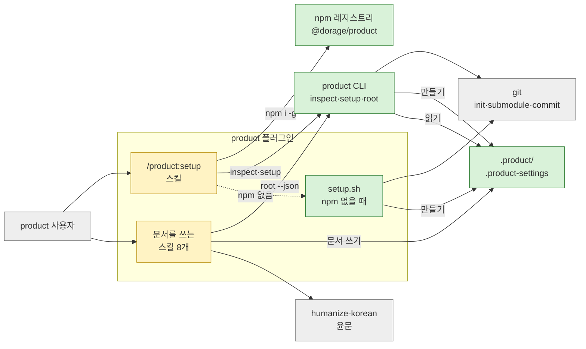
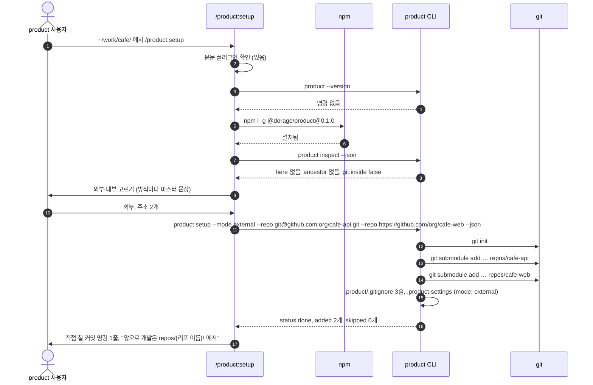
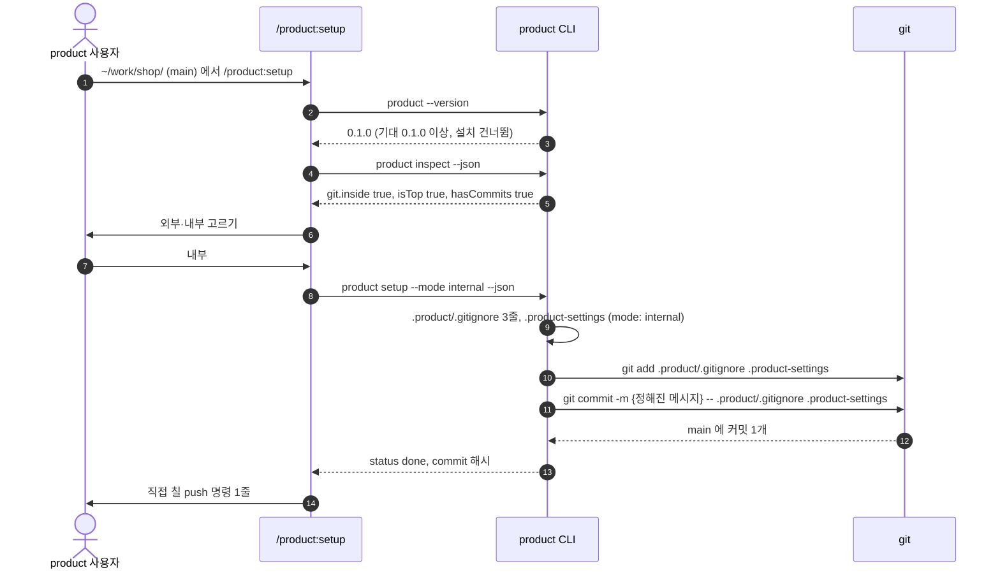
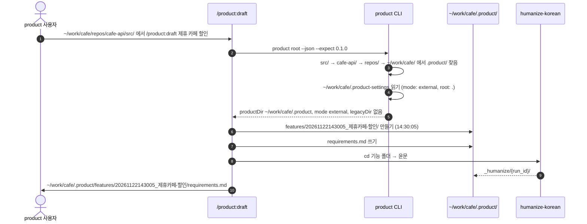

# product 셋업 방식 설계

- 기준 날짜: 2026-11-22
- 기준 코드: `origin/main` b16cd27
- 입력 요구사항 문서: `.product/features/261122_setup-method/requirements.md`

## 필요한 결정

요구사항 문서에는 열린 결정이 없다. 아래는 설계에서 드러난 결정이다.

### 열린 결정

없음

### 정해진 결정

2026-11-23 마스터 답 "모두 추천안으로" 로 아래 결정을 모두 추천안(이탤릭은 적용한 안)으로 정했다.

| ID | 정한 것 | 답 | 반영한 곳 |
| --- | --- | --- | --- |
| S1 | CLI 는 마스터가 손으로 npm 에 낸다 | @확정 (2026-11-23 "모두 추천안으로") | 안전망 단계 배포, 컴포넌트 설계 `packages/cli/` 패키지 |
| S2 | CLI 코드는 이 리포 `packages/cli/` 에 둔다 | @확정 (2026-11-23 "모두 추천안으로") | 컴포넌트 설계 `packages/cli/` 패키지, 리포 `.gitignore` |
| S3 | CLI 는 TypeScript 를 `tsc` 로 `dist/` 에 빌드한 JS 로 낸다 | @확정 (2026-11-23 "모두 추천안으로") | 컴포넌트 설계 `packages/cli/` 패키지 |
| S4 | 기대 CLI 버전은 `plugins/product/cli-version` 파일 한 줄에 둔다 | @확정 (2026-11-23 "모두 추천안으로") | 컴포넌트 설계 `cli-version`, 데이터 흐름, 안전망 단계 배포 |
| S5 | 플러그인 버전을 0.11.0 으로 올린다 | @확정 (2026-11-23 "모두 추천안으로") | 컴포넌트 설계 플러그인 정보, 테스트 전략 E2E |
| T1 | CLI 하위 명령은 `inspect`·`setup`·`root` 셋이고 종료 코드로 갈래를 알린다 | @확정 (2026-11-23 "모두 추천안으로") | 컴포넌트 설계 `cli.ts`·`inspect.ts`, 오류 처리 머리말과 E24, 시퀀스 다이어그램 세 그림 |
| T2 | CLI 버전이 기대 버전 이상이면 통과로 본다. CLI 는 한 번 낸 옵션을 다음 버전에서 지우지 않는다 | @확정 (2026-11-23 "모두 추천안으로") | 컴포넌트 설계 `version.ts`, 오류 처리 E17·E20·E22 |
| T3 | 스킬은 전역 `product` 명령을 부른다 | @확정 (2026-11-23 "모두 추천안으로") | 컴포넌트 설계 저장 위치, 시퀀스 다이어그램 draft |
| T4 | 기능 폴더 만들기와 고르기는 CLI 에 넣지 않고 spec-format 셸 명령에 남긴다 | @확정 (2026-11-23 "모두 추천안으로") | 컴포넌트 설계 저장 위치, 데이터 흐름 기능 폴더 |
| T5 | 설정 파일은 `yaml` 패키지로 읽고, 형식 번호 키는 두지 않는다 | @확정 (2026-11-23 "모두 추천안으로") | 컴포넌트 설계 `settings.ts`, 데이터 흐름 `.product-settings` |
| U1 | npm 없는 셋업은 셸 스크립트 파일 `setup.sh` 하나로 두고 CLI 와 같은 통합 테스트를 돌린다. 전역 지시 "셸 스크립트는 tsx" 보다 마스터의 명시 지시 H2 를 따른다 | @확정 (2026-11-23 "모두 추천안으로") | 컴포넌트 설계 `setup.sh`, 테스트 전략 통합 |
| U2 | 표준 입력이 터미널이 아닐 때만 git 이 비밀번호나 키 암호를 묻지 않게 한다 | @확정 (2026-11-23 "모두 추천안으로") | 컴포넌트 설계 `git.ts`, 오류 처리 E10 |
| U3 | 내부 셋업 커밋은 두 파일을 경로로 지정해 커밋한다 | @확정 (2026-11-23 "모두 추천안으로") | 컴포넌트 설계 `setupInternal.ts`, 시퀀스 다이어그램 내부 셋업 |
| V1 | product 폴더 찾기 절차는 spec-format 「저장 위치」 한 곳에 두고 8개 스킬은 가리키기만 한다 | @확정 (2026-11-23 "모두 추천안으로") | 컴포넌트 설계 저장 위치, 8개 스킬의 「입력 찾기」 |
| V2 | 경로를 받아도 `product root --from {경로}` 로 셋업 방식만 읽는다 | @확정 (2026-11-23 "모두 추천안으로") | 컴포넌트 설계 저장 위치, 오류 처리 E15 |
| V3 | 답한 사람은 답 원문 뒤에 ` — {user.name}` 으로 붙인다 | @확정 (2026-11-23 "모두 추천안으로") | 컴포넌트 설계 결정 기록 표 |
| V4 | 윤문은 기능 폴더로 옮겨 가서 부르고, 끝나면 기능 폴더와 세션 폴더 두 곳에서 `_workspace/` 를 찾아 옮긴다 | @확정 (2026-11-23 "모두 추천안으로") | 컴포넌트 설계 윤문 작업 파일 치우기 |
| V5 | 경로를 받았는데 그 위 product 폴더의 설정 파일이 없거나 깨졌으면, 문제를 한 줄로 알리고 외부 셋업으로 보고 그 경로에 쓴다. 채팅에서는 "A1" 로 물었다 | @확정 (2026-11-23 "A1. a안.") | 오류 처리 E23, 안전망 비상 탈출구 |

## 시스템 아키텍처

새 product CLI(`@dorage/product`)를 이 리포 `packages/cli/` 에서 npm 으로 배포하고, setup 스킬은 그 CLI 를 설치해 셋업을 맡기고, 문서를 쓰는 8개 스킬은 공용 포맷(spec-format 「저장 위치」)에서 그 CLI 로 product 폴더를 찾는다.

초록은 새로 만드는 것, 노랑은 고치는 것, 회색은 그대로 쓰는 것이다. 점선은 npm 이 없는 컴퓨터에서만 타는 길이고, 이 길로 셋업해도 문서를 쓰는 스킬은 CLI 가 생길 때까지 쓰지 않는다(요구사항 5 인수 조건 10).

## 컴포넌트 설계

| 컴포넌트 | 책임 | 인터페이스 | 의존 | 추적 | 표기 |
| --- | --- | --- | --- | --- | --- |
| `packages/cli/` 패키지 `@dorage/product` (새) | CLI 를 npm 배포 단위 하나로 묶는다 | `package.json` 의 `bin.product` → `dist/cli.js`, `engines.node` `>=20` | `yaml` | 요구사항 5 인수 조건 1·2, 요구사항 5 설치 | @확정 (H5, 2026-11-22) (이름), @확정 (S2, S3, 2026-11-23) |
| `packages/cli/src/cli.ts` (새) | 명령 줄을 해석해 하위 명령에 넘기고 결과를 종료 코드와 출력으로 돌려준다 | `product inspect`, `product setup`, `product root`, `product --version`. 공통 옵션 `--json`, `--expect <버전>`. 종료 코드는 「오류 처리」 감지 칸 | 아래 모듈, `node:util` `parseArgs`, `node:readline/promises` | 요구사항 5 인수 조건 6·7 | @확정 (T1, 2026-11-23) |
| `packages/cli/src/find.ts` (새) | 시작 폴더에서 파일 시스템 맨 위까지 올라가며 `.product/` 폴더가 있는 가장 가까운 폴더를 찾는다 | `findProduct(from: string): { productDir: string; settingsFile: string } \| null` | `node:fs` | 요구사항 4 인수 조건 2·7, 요구사항 1 인수 조건 4 | @확정 (A2, B4, 2026-11-22) |
| `packages/cli/src/settings.ts` (새) | `.product-settings` 를 쓰고, 읽고, 키를 검사한다 | `writeSettings(rootDir: string, mode: "external" \| "internal"): string`, `readSettings(file: string): Settings` (실패하면 `SettingsError { file, reason }`) | `yaml` | 요구사항 6 인수 조건 1~6·8 | @확정 (T5, 2026-11-23) |
| `packages/cli/src/inspect.ts` (새) | 셋업 전에 스킬이 물을 것을 정하도록 지금 폴더 상황을 알려 준다 | `inspect(cwd: string): Inspection` → `{ here: { productDir, settings: "ok" \| "missing" \| "invalid", mode } \| null, ancestor: string \| null, git: { inside, top, isTop, hasCommits } }` | `find.ts`, `settings.ts`, `git.ts` | 요구사항 1 인수 조건 3·4·7, 요구사항 2 인수 조건 6·7, 요구사항 3 인수 조건 2·3, 요구사항 6 인수 조건 7 | @확정 (T1, 2026-11-23) |
| `packages/cli/src/setupExternal.ts` (새) | 지금 폴더를 product 루트로 만들고 리포를 `repos/` 아래 submodule 로 더한다 | `setupExternal(cwd, { repos: string[], useExistingRepo: boolean, allowNested: boolean }): SetupResult` → `{ status, mode, productDir, added[], skipped[{ url, name, reason }], next[] }` | `git.ts`, `repoName.ts`, `settings.ts` | 요구사항 2 인수 조건 1~13 | @확정 (B1, F1, F2, E2, 2026-11-22) |
| `packages/cli/src/setupInternal.ts` (새) | 리포 안에 `.product/` 를 만들고 두 파일만 담은 커밋 1개를 만든다 | `setupInternal(cwd, { at: "top" \| "here", allowNested: boolean }): SetupResult` → `{ status, mode, productDir, commit: string \| null, next[] }` | `git.ts`, `settings.ts` | 요구사항 3 인수 조건 1~9 | @확정 (B3, B5, B6, H7, 2026-11-22), @확정 (U3, 2026-11-23) |
| `packages/cli/src/repoName.ts` (새) | 리포 주소에서 `repos/` 아래 이름을 뽑는다 | `repoName(url: string): string` | — | 요구사항 2 인수 조건 3, 요구사항 2 리포 이름 | 요구사항 2 리포 이름 표의 표기를 따른다 |
| `packages/cli/src/git.ts` (새) | git 을 실행한다. 표준 입력이 터미널이 아니면 비밀번호를 묻지 않는 환경으로 실행한다 | `git(args: string[], cwd: string): { code, stdout, stderr }` | `node:child_process`, git | 요구사항 2 인수 조건 8 | @확정 (U2, 2026-11-23) |
| `packages/cli/src/version.ts` (새) | 지금 CLI 버전이 기대 버전 이상인지 판단한다 | `atLeast(have: string, want: string): boolean`. 자리마다 숫자로 비교한다 (0.10.0 > 0.9.0) | — | 요구사항 5 인수 조건 3·8·11 | @확정 (T2, 2026-11-23) |
| `packages/cli/src/legacy.ts` (새) | 예전 보관 폴더 `~/.sdd/{리포 이름}/` 이 있으면 경로를 알려 준다. 읽기만 한다 | `legacyDir(cwd: string, home: string): string \| null`. 이름은 지금 setup 「이름 정하기」와 같은 순서로 정한다 | `git.ts`, `node:fs` | 요구사항 4 인수 조건 8·9 | @확정 (C1, 2026-11-22) |
| `plugins/product/cli-version` (새) | 플러그인이 기대하는 CLI 버전을 한 곳에 둔다 | 버전 한 줄 (예: `0.1.0`) | — | 요구사항 5 인수 조건 3·8·11 | @확정 (S4, 2026-11-23) |
| `plugins/product/skills/setup/setup.sh` (새) | npm 이 없는 컴퓨터에서 CLI 대신 같은 셋업을 한다 | `setup.sh inspect`, `setup.sh external <주소>...`, `setup.sh internal top\|here`, `setup.sh settings-only <방식>`. 상태 한 줄(`DONE`·`ALREADY`·`STOPPED`·`COMMIT_FAILED`)과 다음 명령을 찍는다 | git, `sh` | 요구사항 5 인수 조건 4 | @확정 (H2, 2026-11-22), @확정 (U1, 2026-11-23) |
| setup 스킬 (기존, 바뀜) | 윤문 플러그인과 CLI 를 준비하고, 질문을 모아 CLI 에 넘기고, 결과를 알린다 | `/product:setup`. 「이름 정하기」와 `~/.sdd` 를 만드는 명령 절반을 지우고 「CLI 준비」「질문」「셋업 실행」「답하기」로 바꾼다. 윤문 플러그인 명령 절반은 그대로 둔다 | `product` 또는 `setup.sh`, `AskUserQuestion` | 요구사항 1 인수 조건 1~8, 요구사항 5 인수 조건 1~8 | @사실 (`plugins/product/skills/setup/SKILL.md`) |
| 저장 위치 (기존, 바뀜) | 문서를 쓰는 스킬 8개가 쓸 자리를 정하는 절차를 한 곳에 둔다 | spec-format 「저장 위치」. 「경로」의 `~/.sdd/{리포 폴더}/` 를 「product 폴더 찾기」(`product root --json --expect $(cat cli-version)`)로, 「폴더 고르기」의 대상을 `{product 폴더}/features/` 로 바꾼다 | `product` | 요구사항 4 인수 조건 1~10, 요구사항 5 인수 조건 9~11, 요구사항 6 인수 조건 4·5 | @사실 (`plugins/product/references/spec-format.md`), @확정 (V1, V2, 2026-11-23) |
| 8개 스킬의 「입력 찾기」·「저장 경로 정하기」 (기존, 변경 없음) | spec-format 「저장 위치」를 가리킨다 | 변경 없음. 절차를 직접 적지 않고 가리키기만 해서 「저장 위치」만 고치면 따라온다 | spec-format | 요구사항 4 인수 조건 2~5 | @사실 (`plugins/product/skills/{draft,persona-review,design,flow,task,bdd,brief-dev,brief-nondev}/SKILL.md`) |
| 윤문 작업 파일 치우기 (기존, 바뀜) | 윤문을 기능 폴더에서 부르고 작업 파일을 기능 폴더 `_humanize/` 로 모은다 | spec-format 「윤문」「부르는 법」 앞에 `cd {기능 폴더}`, 「작업 폴더 치우기」가 기능 폴더와 세션 폴더 두 곳의 `_workspace/` 를 본다 | humanize-korean | 요구사항 4 인수 조건 12, 요구사항 3 인수 조건 4 | @사실 (`plugins/product/references/spec-format.md`), @확정 (V4, 2026-11-23) |
| 결정 기록 표 (기존, 바뀜) | 내부 셋업 문서의 답 옆에 답한 사람을 적는다 | spec-format 「정해진 결정」 답 모양과 `references/draft.md` 「결정 기록」 마스터 답 칸 | `git config user.name` | 요구사항 4 인수 조건 13·14 | @사실 (`plugins/product/references/spec-format.md`, `plugins/product/references/draft.md`), @확정 (V3, 2026-11-23) |
| 내부 셋업 문서에 쓰지 않을 것 (기존 규칙에 더함) | 셋업 방식이 내부면 개인 설정과 이 컴퓨터 사실을 채팅에만 남긴다 | spec-format 「저장 위치」에 한 문단. 셋업 방식은 `product root` 결과의 `mode` 로 안다 | `product` | 요구사항 4 인수 조건 11 | @사실 (`plugins/product/references/spec-format.md` 에 해당 규칙이 없다) |
| 문서 모양 (기존, 변경 없음) | 단계마다 결과물 모양을 정한다 | 변경 없음. 설정 파일의 `templates` 는 비워 둔다 | — | 요구사항 6 인수 조건 6 | @사실 (`plugins/product/references/*.md`), @확정 (H8, 2026-11-22) |
| 스킬 안내 예시 경로 (기존, 바뀜) | 예시를 새 기능 폴더 모양으로 보여 준다 | `skills/draft/SKILL.md`·`skills/design/SKILL.md` 끝맺음 예시, `skills/task/SKILL.md`·`skills/bdd/SKILL.md` 「저장 위치」 예시, `references/flow.md` 입력 예시, `OUTPUT.md` 「어디에 남는가」, `WORKFLOW.md` setup 줄, `README.md` setup 줄과 보관 폴더 문장, setup `description` | — | 요구사항 4 인수 조건 1·4 | @사실 (`git grep '\.sdd' origin/main -- plugins`) |
| 플러그인 정보 (기존, 바뀜) | 플러그인 버전과 설명을 새 동작에 맞춘다 | `plugins/product/.claude-plugin/plugin.json` `version` 0.10.0 → 0.11.0, `description` 의 `~/.sdd` 문장 | — | 요구사항 4 인수 조건 1 | @사실 (`plugins/product/.claude-plugin/plugin.json`), @확정 (S5, 2026-11-23) |
| 평가 (기존, 변경 없음) | 스킬 결과물이 포맷을 지키는지 본다 | 변경 없음. 모든 case 프롬프트가 `out/…` 경로를 주므로 「저장 위치」의 경로 갈래를 탄다 | `claude plugin eval` | 요구사항 4 인수 조건 6 | @사실 (`plugins/product/evals/*/*/case.yaml`) |
| npm 패키지 자리 (기존 없음) | — | 리포에 `package.json` 이 없고, 스크립트는 `npx tsx` 로 돌리는 평가 스크립트뿐이다. CLI 테스트도 같은 `npx tsx --test` 를 쓴다 | — | 요구사항 5 인수 조건 1 | @사실 (`git ls-tree -r origin/main`, `plugins/product/evals/README.md`) |
| 리포 `.gitignore` (기존, 바뀜) | CLI 빌드 결과와 의존성을 커밋에서 뺀다 | `node_modules/`, `packages/cli/dist/` 두 줄을 더한다 | — | 요구사항 5 인수 조건 1 | @사실 (`.gitignore`) |
| 워크트리 자리 (기존, 변경 없음) | 워크트리를 리포 안 `.worktrees/` 에 둔다 | 변경 없음. `find.ts` 가 워크트리 안 `.product/` 를 먼저 만나고, 없으면 메인 체크아웃까지 올라간다 | — | 요구사항 4 인수 조건 7 | @사실 (`.gitignore` 의 `.worktrees/`) |
| 예전 sdd 플러그인 (기존, 변경 없음) | — | 변경 없음. 지우는 것은 요구사항 문서 「별개 작업」이다. 이 리포 밖 설정이라 경로를 적지 않는다 | — | — | 확인하지 않았다 (이 리포 밖) |

**요구사항에서 문자 그대로 따른 자리**

- 「저장 위치」는 경로를 받아도 `product` 명령이 없으면 문서를 쓰지 않는다. @가정 (요구사항 5 인수 조건 10 문자 그대로. 요구사항 4 인수 조건 6 과 부딪힘)
    - 경로를 받으면 CLI 없이 쓰는 것으로 정해지면: CLI 확인을 경로 없는 갈래로 옮긴다. 요구사항 4 인수 조건 10·11·13 판단은 CLI 가 있을 때만 하고, 없으면 외부 셋업으로 본다. 평가 case 가 `product` 명령 없는 컴퓨터에서도 돈다
- `.product/` 는 있는데 설정 파일이 없을 때 setup 은 설정 파일만 만들고 내부 셋업이어도 커밋하지 않는다. 직접 칠 커밋 명령을 보여 준다. @가정 (요구사항 6 인수 조건 7 에 커밋 이야기가 없다)
    - 커밋하는 것으로 정해지면: `setupInternal.ts` 의 커밋 단계를 `settings-only` 에도 태우고, 담는 파일은 `.product-settings` 하나다

## 시퀀스 다이어그램

요구사항 문서 「문서가 쌓이는 흐름」의 두 프로덕트(`~/work/cafe/`, `~/work/shop/`)를 그대로 쓴다. 기대 CLI 버전은 `0.1.0` 으로 둔다.

### 외부 셋업은 CLI 를 깔고 질문을 모은 뒤 명령 한 번으로 리포 2개를 repos 아래에 더한다

스킬은 `inspect` 결과로 물을 것만 고르고(요구사항 5 인수 조건 6), CLI 는 받은 옵션만으로 끝까지 간다. 리포 하나를 못 받으면 그 리포만 `skipped` 에 들어간다 (「오류 처리」 E7).

### 내부 셋업은 지금 브랜치에 두 파일만 담은 커밋 1개를 만들고 멈춘다

마지막 `git commit` 이 경로 두 개를 받아서 사용자가 미리 올려 둔 다른 변경은 커밋에 들어가지 않고 그대로 올라가 있다 (U3).

### draft 는 세 단계 위 product 폴더를 CLI 로 찾아 그 안에 기능 폴더를 만든다

draft 가 아닌 스킬은 5번 대신 `features/` 아래 폴더를 최신순 4개까지 보여 주고 고르게 한다. 내부 셋업 `~/work/shop/` 에서 부르면 3번에서 바로 `~/work/shop/.product/` 를 찾는다.

## 데이터 흐름

데이터베이스가 없어서 erDiagram 은 그리지 않는다. 모든 데이터는 파일이다. 설정 파일에 들어가는 키와 값은 요구사항 6 「설정 파일 내용」 표에 있다.

- `.product-settings`
    - 생성: `settings.ts` `writeSettings` 또는 `setup.sh`. 셋업을 마칠 때, 그리고 `.product/` 만 있을 때(요구사항 6 인수 조건 7)
    - 저장소: product 루트 폴더의 파일. 외부 셋업은 사용자가 커밋하고, 내부 셋업은 셋업 커밋에 들어간다
    - 읽는 곳: `product root`, `product inspect`. 스킬은 파일을 직접 읽지 않고 `product root --json` 결과만 쓴다
    - 보존: 사람이 지울 때까지 (요구사항 3 범위 밖, G2)
    - 읽기 규칙: `mode` 가 `external`·`internal` 이 아니거나, `root` 가 문자열이 아니거나, `templates` 가 맵이 아니면 깨진 파일로 본다. 모르는 키는 무시한다 @확정 (T5, 2026-11-23)
    - `root` 는 설정 파일이 있는 폴더를 기준으로 풀어서 절대 경로로 돌려준다. `root: .` 이면 설정 파일이 있는 폴더다
- `.product/.gitignore`
    - 생성: 두 셋업이 `.product/` 를 만들 때 함께 만든다. 이미 있으면 덮어쓰지 않는다 @초안
    - 저장소: product 폴더 안. 내용은 요구사항 3 인수 조건 4
    - 읽는 곳: git
    - 보존: 사람이 지울 때까지
- `.gitmodules` 와 `repos/{리포 이름}/` (외부 셋업)
    - 생성: `git submodule add`. git 이 `.gitmodules` 와 `repos/{리포 이름}` 을 커밋 대상으로 올려 둔다 @사실 (scratchpad 실험, git 2.52.0)
    - 저장소: product 루트. 커밋은 사용자가 한다 (F1)
    - 읽는 곳: git, 사용자
    - 보존: 사람이 지울 때까지
- 기능 폴더와 문서
    - 생성: draft 가 `{product 폴더}/features/{YYYYmmddHHMMSS}_{요청내용}/` 을 만든다. 이름 규칙은 요구사항 4 「기능 폴더 이름」 표
    - 저장소: product 폴더 안. 내부 셋업은 사용자가 리포에 커밋한다 (D2)
    - 읽는 곳: 문서를 쓰는 스킬 8개. 고르기는 폴더 이름의 내림차순으로 4개다. 이름이 14자리 숫자로 시작하지 않는 폴더는 맨 뒤에 놓는다 @초안
    - 보존: 사람이 지울 때까지
- `_humanize/{run_id}/` 와 `.{파일 이름}.before`
    - 생성: humanize-korean 이 지금 폴더 `_workspace/{run_id}/` 에 만들고, 스킬이 기능 폴더 `_humanize/` 로 옮긴다
    - 저장소: 기능 폴더 안. `.product/.gitignore` 가 커밋에서 뺀다
    - 읽는 곳: 사람 (윤문 전 원문 확인)
    - 보존: 사람이 지울 때까지
- 기대 CLI 버전 `plugins/product/cli-version`
    - 생성: CLI 를 새로 배포할 때 사람이 고친다
    - 저장소: 플러그인 폴더. 설치하면 플러그인 캐시로 함께 복사된다
    - 읽는 곳: setup 스킬(설치할 버전), 「저장 위치」 절차(`--expect` 값)
    - 보존: 플러그인 버전마다 하나
- 전역 CLI 설치본
    - 생성: `npm i -g @dorage/product@{기대 버전}`
    - 저장소: npm 전역 폴더(`npm config get prefix` 아래). 컴퓨터에 하나다
    - 읽는 곳: 모든 리포의 setup 과 문서를 쓰는 스킬
    - 보존: 다음 설치가 덮어쓸 때까지
- 예전 보관 폴더 `~/.sdd/{리포 이름}/`
    - 생성: 이번 작업은 만들지 않는다 (요구사항 1 인수 조건 6)
    - 읽는 곳: `legacy.ts` 가 있는지만 본다. 안의 파일은 열지 않는다
    - 보존: 그대로 둔다 (C1)

**명세화**

- 버전 비교: 점으로 나눈 세 자리를 각각 정수로 비교한다. 문자열로 비교하면 0.10.0 이 0.9.0 보다 작게 나온다. 시험판 꼬리(`-beta.1`)는 이번 작업에서 쓰지 않으며, 붙어 있으면 버전을 읽을 수 없는 것으로 본다 @초안
- 기능 폴더 시각: 폴더를 만드는 순간의 로컬 시각이다. 요구사항 4 「기능 폴더 이름」 표를 따른다

## 오류 처리

CLI 종료 코드는 0 성공, 1 그 밖의 실패, 2 답이 더 필요함, 3 product 폴더 없음, 4 설정 파일 문제, 5 CLI 버전이 낮음, 6 셋업을 멈춤, 7 커밋 실패다. `--json` 이면 실패해도 표준 출력에 `{ status, reason, next[] }` 를 남긴다. @확정 (T1, 2026-11-23)

| ID | 발생 자리 | 감지 | 사용자에게 보이는 것 | 복구 | 실패 방향 | 추적 | 표기 |
| --- | --- | --- | --- | --- | --- | --- | --- |
| E1 | setup, 지금 폴더에 `.product/` 와 설정 파일이 있음 | `inspect` 의 `here.settings` 가 `ok` | 셋업 방식과 경로 한 줄 | 셋업을 건너뛰고 윤문 플러그인 확인만 한다 | 시끄러움 | 요구사항 1 인수 조건 3·7·8 | @확정 (B2, 2026-11-22) |
| E2 | setup, 지금 폴더에 `.product/` 만 있고 설정 파일이 없음 | `here.settings` 가 `missing` | 셋업 방식 질문 | `product setup --settings-only --mode {방식}` | 시끄러움 | 요구사항 6 인수 조건 7 | @확정 (H10, 2026-11-22) |
| E3 | setup, 지금 폴더 위쪽에 product 폴더가 있음 | `inspect` 의 `ancestor` 가 경로 | 그 경로와 "그래도 여기에 셋업할지" 질문 | 예 → `--allow-nested` 를 붙여 다시 부른다. 아니오 → 끝낸다 | 시끄러움 | 요구사항 1 인수 조건 4 | @확정 (A2, E1, 2026-11-22) |
| E4 | 외부 셋업, 지금 폴더가 git 리포가 아님 | `git rev-parse --is-inside-work-tree` 실패 | 없음 | `git init` 뒤 계속한다 | 조용함 | 요구사항 2 인수 조건 5 | @확정 (B1, 2026-11-22) |
| E5 | 외부 셋업, 지금 폴더가 다른 리포의 하위 폴더 | `git rev-parse --show-toplevel` 이 지금 폴더와 다름. 종료 코드 6 | 멈춘다는 것과 리포 밖 폴더에서 다시 부르라는 안내 | 없음 | 시끄러움 | 요구사항 2 인수 조건 6 | 요구사항 2 인수 조건 6 의 표기 |
| E6 | 외부 셋업, 지금 폴더가 커밋이 있는 리포 | `git rev-parse HEAD` 성공, `--use-existing-repo` 없음. 종료 코드 2 | 이 리포를 product 루트로 써도 되는지 질문 | 예 → `--use-existing-repo` 로 다시 부른다 | 시끄러움 | 요구사항 2 인수 조건 7 | 요구사항 2 인수 조건 7 의 표기 |
| E7 | 외부 셋업, `git submodule add` 실패 | 종료 코드가 0 이 아님. 이유는 표준 오류의 마지막 `fatal:` 줄 | 주소와 이유, 직접 칠 `git submodule add` 명령 | 그 리포만 건너뛴다. git 이 `repos/{이름}`·`.git/modules/repos/{이름}`·`.gitmodules` 를 되돌려 두므로 보여 준 명령을 그대로 칠 수 있다 @사실 (scratchpad 실험, git 2.52.0). 흔적이 남아 있으면 이번 실행이 만든 그 리포 폴더만 지운다 @초안 | 시끄러움 | 요구사항 2 인수 조건 8·12 | 요구사항 2 인수 조건 8 의 표기 |
| E8 | 외부 셋업, 한 번의 셋업에서 리포 이름이 겹침 | `repoName` 결과가 앞 주소와 같음 | 두 번째 주소와 이름이 겹친다는 알림, 직접 칠 명령 | 두 번째 주소를 건너뛴다 | 시끄러움 | 요구사항 2 리포 이름, 요구사항 2 인수 조건 12 | 요구사항 2 리포 이름 표의 표기 |
| E9 | 외부 셋업, 받은 리포가 0개 | `added` 가 빔 | 건너뛴 리포마다 명령, 커밋 명령 | `.product/` 와 설정 파일을 만들고 마친다 | 시끄러움 | 요구사항 2 인수 조건 11·12 | @확정 (F2, 2026-11-22) |
| E10 | 외부 셋업을 스킬이 부른 실행에서, 비공개 리포가 비밀번호나 키 암호를 물음 | `GIT_TERMINAL_PROMPT=0` 과 ssh `BatchMode=yes` 로 git 이 묻지 않고 실패한다 | E7 과 같다 | E7 과 같다 | 시끄러움 (묻는 창을 기다리며 멈추는 대신) | 요구사항 2 인수 조건 8 | @확정 (U2, 2026-11-23) |
| E11 | 내부 셋업, 지금 폴더가 리포 맨 위가 아님 | `inspect` 의 `git.isTop` 이 false, `--at` 없음. 종료 코드 2 | 리포 맨 위와 지금 폴더 중 고르기 | `--at top` 또는 `--at here` 로 다시 부른다 | 시끄러움 | 요구사항 3 인수 조건 2 | 요구사항 3 인수 조건 2 의 표기 |
| E12 | 내부 셋업, 지금 폴더가 git 리포 밖 | `git.inside` 가 false. 종료 코드 6 | 멈춘다는 것과 외부 셋업 권유 | 없음 | 시끄러움 | 요구사항 3 인수 조건 3 | 요구사항 3 인수 조건 3 의 표기 |
| E13 | 내부 셋업, `git commit` 실패 (리포 훅, 서명 설정, 커밋 메시지 규칙) | 종료 코드가 0 이 아님. 종료 코드 7 | 이유와 직접 칠 커밋 명령 | `.product/` 와 설정 파일을 남긴다. `--no-verify` 로 리포 규칙을 우회하지 않는다 | 시끄러움 | 요구사항 3 인수 조건 9 | 요구사항 3 인수 조건 9 의 표기 |
| E14 | 문서를 쓰는 스킬, 위로 올라가도 product 폴더가 없음 | `product root` 종료 코드 3 | `/product:setup` 을 먼저 부르라는 안내 | 문서를 쓰지 않는다 | 시끄러움 | 요구사항 4 인수 조건 3 | @확정 (A3, 2026-11-22) |
| E15 | 문서를 쓰는 스킬, 받은 경로가 외부 셋업 `repos/` 아래 | `product root --from {경로}` 의 `inRepos` 가 리포 이름 | 실제 리포 안이라 관리자에게 보일 수 있다는 한 줄 | 그 경로에 그대로 쓴다 | 시끄러움 | 요구사항 4 인수 조건 10 | @확정 (F4, 2026-11-22) |
| E16 | 결정 기록, `git config user.name` 이 빔 | 명령 결과가 빈 줄 | 답 옆 "이름 없음", 끝맺음에 `git config --global user.name "{이름}"` | 없음 | 시끄러움 | 요구사항 4 인수 조건 14 | 요구사항 4 인수 조건 14 의 표기 |
| E17 | setup, 맞는 버전의 CLI 가 이미 있음 | `product --version` 이 `cli-version` 이상 | 없음 | 설치를 건너뛴다 | 조용함 | 요구사항 5 인수 조건 3 | @확정 (H3, 2026-11-22), @확정 (T2, 2026-11-23) |
| E18 | setup, npm 이 없음 | `command -v npm` 실패 | 셋업 결과와 함께 "CLI 가 없어서 문서를 쓰는 스킬은 node 설치 뒤 쓸 수 있다" 한 줄 | `setup.sh` 로 셋업한다 | 시끄러움 | 요구사항 5 인수 조건 4 | @확정 (H2, 2026-11-22) |
| E19 | setup, `npm i -g` 실패 (전역 폴더 권한) | npm 종료 코드가 0 이 아님 | 이유 한 줄과 `npm i -g @dorage/product@{기대 버전}` | 폴더 셋업은 하지 않고 멈춘다. 윤문 플러그인 확인은 한다 @가정 (요구사항 5 인수 조건 5 문자 그대로) | 시끄러움 | 요구사항 5 인수 조건 5 | 요구사항 5 인수 조건 5 의 표기 |
| E20 | setup, 설치된 CLI 가 기대 버전보다 낮음 | `atLeast` 가 false | 바꾼 버전 한 줄 (예: 0.1.0 → 0.2.0) | `npm i -g @dorage/product@{기대 버전}` 로 다시 설치한다 | 시끄러움 | 요구사항 5 인수 조건 8 | @확정 (H3, 2026-11-22), @확정 (T2, 2026-11-23) |
| E21 | 문서를 쓰는 스킬, `product` 명령이 없음 | `command -v product` 실패 | CLI 가 없다는 것과 node 를 설치한 뒤 `/product:setup` 을 다시 부르라는 안내 | 문서를 쓰지 않는다 | 시끄러움 | 요구사항 5 인수 조건 10 | @확정 (H9, 2026-11-22) |
| E22 | 문서를 쓰는 스킬, CLI 가 기대 버전보다 낮음 | `product root --expect` 종료 코드 5 | `/product:setup` 을 다시 부르라는 안내 | 문서를 쓰지 않는다 | 시끄러움 | 요구사항 5 인수 조건 11 | @확정 (H3, 2026-11-22) |
| E23 | 문서를 쓰는 스킬, 찾은 product 폴더 옆 설정 파일이 없거나 깨짐 | `product root` 종료 코드 4, `reason` 에 파일 경로와 이유 (예: `mode: extrnal` 은 모르는 값) | 어느 파일이 왜 문제인지와 `/product:setup` | 문서를 쓰지 않는다. 경로를 받았으면 외부 셋업으로 보고 그 경로에 쓴다 @확정 (V5, 2026-11-23) | 시끄러움 | 요구사항 6 인수 조건 5 | 요구사항 6 인수 조건 5 의 표기 |
| E24 | CLI, 스킬이 부른 실행에서 옵션이 모자람 | 표준 입력이 터미널이 아니고 필요한 옵션이 없음. 종료 코드 2, `need` 에 빠진 옵션 | 없음 (스킬이 그 질문을 하고 다시 부른다) | 묻는 창을 띄우지 않고 바로 끝낸다 | 시끄러움 (기다리며 멈추는 대신) | 요구사항 5 인수 조건 6·7 | @확정 (T1, 2026-11-23) |

## 안전망

이번 변경은 데이터를 지우거나 옮기지 않는다. `~/.sdd/` 는 그대로 남고(C1), 셋업은 파일을 더하기만 한다. 되돌릴 수 없는 것은 npm 에 한 번 낸 버전 번호 하나다.

- 즉시 되돌림
    - 장치: 플러그인 변경 머지 커밋을 `git revert` 한다. 사용자가 `/plugin update` 를 하면 예전 `~/.sdd/` 동작으로 돌아간다. 새로 생긴 `.product/` 는 예전 스킬이 읽지 않을 뿐 해가 없다 @초안
    - 걸린 컴포넌트: 저장 위치, setup 스킬, 플러그인 정보
    - 쓰는 때: 새 버전에서 문서를 쓰는 스킬이 product 폴더를 못 찾는 일이 이어질 때
- npm 버전 보호
    - 장치: 잘못 낸 CLI 버전은 지우지 않고 `npm deprecate @dorage/product@{버전} "{이유}"` 로 표시한 뒤 고친 다음 버전을 낸다. 한 번 낸 버전 번호는 다시 쓸 수 없어서 되돌리지 않고 앞으로 고친다 @초안
    - 걸린 컴포넌트: `packages/cli/`, `cli-version`
    - 쓰는 때: 낸 버전에서 셋업이나 `product root` 가 틀리게 동작할 때
- 단계 배포
    - 장치: CLI 를 먼저 npm 에 내고, `npm view @dorage/product version` 이 새 버전을 보여 준 뒤에 `cli-version` 을 올린 플러그인을 머지한다. 이 리포는 지금 브랜치의 플러그인을 바로 쓰므로 마스터가 먼저 써 보고, 다른 리포는 `/plugin update` 를 할 때 받는다 @확정 (S1, 2026-11-23)
    - 걸린 컴포넌트: `cli-version`, setup 스킬
    - 쓰는 때: CLI 버전을 올릴 때마다. 순서가 바뀌면 setup 이 아직 없는 버전을 설치하다 E19 로 멈춘다
- 데이터 보호
    - 장치: 내부 셋업 커밋은 두 파일만 담고 push 하지 않는다(B6). 잘못 셋업했으면 push 전에 `git reset --soft HEAD~1` 로 커밋만 거둔다. 외부 셋업은 커밋하지 않는다(F1) @초안
    - 걸린 컴포넌트: `setupInternal.ts`, `setupExternal.ts`
    - 쓰는 때: 셋업 방식을 잘못 골랐을 때 (방식 바꾸기는 요구사항 1 범위 밖이라 사람이 지우고 다시 셋업한다)
- 비상 탈출구
    - 장치: 경로를 주고 스킬을 부르면 product 폴더 찾기를 건너뛴다(요구사항 4 인수 조건 6). 예전 `~/.sdd/` 기능도 경로로 이어 쓴다 (요구사항 4 인수 조건 9) @초안
    - 걸린 컴포넌트: 저장 위치
    - 쓰는 때: `product root` 가 엉뚱한 product 폴더를 고를 때. 단 「컴포넌트 설계」의 첫 @가정 대로라면 CLI 가 없을 때는 이 길도 막힌다

## 테스트 전략

테스트 도구는 리포에 이미 있는 `node:test` 와 `npx tsx --test` 를 쓴다 @사실 (`plugins/product/evals/run.test.ts`, `plugins/product/evals/README.md` 「테스트」). CLI 테스트는 `npx tsx --test packages/cli/src/*.test.ts` 로 돌린다. 시나리오 문장은 구현 때 `product:bdd` 가 쓴다.

- 단위
    - `version.ts`: 기대 버전과 같을 때 통과, 셋째 자리 하나 낮을 때 실패, 0.10.0 과 0.9.0 비교, 읽을 수 없는 버전 문자열
    - `repoName.ts`: 요구사항 2 「리포 이름」 표의 세 행이 경계 사례다
    - `settings.ts`: 요구사항 6 「설정 파일 내용」 표의 두 열이 정상 사례이고, 키 빠짐·모르는 `mode`·YAML 이 아닌 글이 깨진 사례다
- 통합 (임시 폴더 + 진짜 git)
    - `find.ts`·`product root`: 요구사항 4 「어디서 부르면 어느 product 폴더를 찾나」 표의 8행을 임시 폴더에 그대로 만들어 행마다 하나씩 확인한다. 워크트리 행은 `git worktree add` 로 만든다
    - `setupExternal.ts`·`setupInternal.ts`: 요구사항 2·3 「폴더 모양」 표의 파일이 생기는지, 실제 리포 안 `git status --porcelain` 이 비어 있는지, 내부 셋업 커밋이 두 파일만 담고 미리 올려 둔 변경이 그대로 남는지 본다
    - 같은 통합 사례를 `setup.sh` 에도 돌린다. 두 셋업이 같은 파일과 같은 상태 줄을 내는지가 통과 기준이다 (U1)
- 테스트 더블
    - GitHub 대신 임시 폴더의 bare 리포를 submodule 주소로 쓴다. git 2.38.1 이후 로컬 파일 주소는 막혀 있어서 테스트에서만 `-c protocol.file.allow=always` 를 넘긴다 @사실 (scratchpad 실험, git 2.52.0 에서 `transport 'file' not allowed`)
    - 받기 실패는 없는 주소(`file:///없는/폴더`)로 만든다
    - `HOME` 을 임시 폴더로 바꿔 `~/.sdd/` 를 만들지 않는지(요구사항 1 인수 조건 6)와 건드리지 않는지(요구사항 4 인수 조건 8)를 본다
    - 터미널 질문(요구사항 5 인수 조건 7)은 표준 입력을 터미널이 아닌 파이프로 주고 종료 코드 2 를 확인하는 데서 멈춘다. 터미널에서 실제로 묻는지는 운영 확인이다
- E2E (Claude 세션에서 스킬 실행)
    - 이번 작업은 평가 case 를 더하지 않는다. 평가는 setup 을 범위 밖으로 둔다 @사실 (`plugins/product/evals/README.md` 「범위 밖」)
    - 기존 평가 9개 case 를 돌려 경로 갈래가 그대로인지 본다. `plugin.json` 둘째 자리를 올리므로 전체 모드로 돈다. 「컴포넌트 설계」의 첫 @가정 대로면 평가를 돌리는 컴퓨터에 `product` 명령이 있어야 한다
- 운영 확인
    - npm 배포: `npm view @dorage/product version` 이 `plugins/product/cli-version` 과 같다
    - 새 컴퓨터 설치: node 만 있는 빈 사용자 계정에서 `/product:setup` 을 부르고 `product --version` 이 기대 버전을 찍는다
    - 두 셋업과 draft: 빈 폴더에서 외부 셋업(로컬 bare 리포 2개) → `repos/{이름}/src/` 에서 `/product:draft` → 문서가 product 루트 `.product/features/` 아래에 생긴다. 리포 폴더에서 내부 셋업 → `git show --stat HEAD` 가 두 파일만 보여 준다
    - 자동으로 지킬 수 없는 인수 조건: 질문에 마스터 문장을 보여 주는지(요구사항 1 인수 조건 2), 윤문 플러그인 설치(요구사항 1 인수 조건 5), 내부 셋업 문서에 개인 설정을 쓰지 않는지(요구사항 4 인수 조건 11), 윤문 작업 파일 자리(요구사항 4 인수 조건 12), 답한 사람 적기(요구사항 4 인수 조건 13·14). 모두 LLM 이 스킬 글을 읽고 하는 일이라 위 세션 확인에서 결과 파일을 눈으로 본다

## 요구사항 추적

인수 조건 63개 중 63개를 가리킨다 (2026-11-22 기준). 시퀀스 칸의 외부 셋업·내부 셋업·draft 는 「시퀀스 다이어그램」의 세 그림이다.

| 인수 조건 | 컴포넌트 | 시퀀스 | 오류 | 테스트 층 |
| --- | --- | --- | --- | --- |
| 요구사항 1 인수 조건 1 | setup 스킬 | 외부 셋업 | — | 운영 확인 |
| 요구사항 1 인수 조건 2 | setup 스킬 | 외부 셋업 | — | 운영 확인 |
| 요구사항 1 인수 조건 3 | `inspect.ts`, setup 스킬 | — | E1 | 통합 |
| 요구사항 1 인수 조건 4 | `inspect.ts`, `find.ts` | — | E3 | 통합 |
| 요구사항 1 인수 조건 5 | setup 스킬 | 외부 셋업 | — | 운영 확인 |
| 요구사항 1 인수 조건 6 | `setupExternal.ts`, `setupInternal.ts`, setup 스킬 | — | — | 통합 |
| 요구사항 1 인수 조건 7 | `inspect.ts`, `settings.ts` | — | E1 | 통합 |
| 요구사항 1 인수 조건 8 | setup 스킬 | — | E1 | 운영 확인 |
| 요구사항 2 인수 조건 1 | `setupExternal.ts` | 외부 셋업 | — | 통합 |
| 요구사항 2 인수 조건 2 | setup 스킬, `cli.ts` | 외부 셋업 | — | 통합 |
| 요구사항 2 인수 조건 3 | `setupExternal.ts`, `repoName.ts` | 외부 셋업 | E8 | 단위, 통합 |
| 요구사항 2 인수 조건 4 | `setupExternal.ts` | 외부 셋업 | — | 통합 |
| 요구사항 2 인수 조건 5 | `setupExternal.ts`, `git.ts` | 외부 셋업 | E4 | 통합 |
| 요구사항 2 인수 조건 6 | `setupExternal.ts`, `inspect.ts` | — | E5 | 통합 |
| 요구사항 2 인수 조건 7 | `inspect.ts`, setup 스킬 | — | E6 | 통합 |
| 요구사항 2 인수 조건 8 | `setupExternal.ts`, `git.ts` | — | E7, E10 | 통합 |
| 요구사항 2 인수 조건 9 | `setupExternal.ts` | — | — | 통합 |
| 요구사항 2 인수 조건 10 | `setupExternal.ts` | 외부 셋업 | — | 통합 |
| 요구사항 2 인수 조건 11 | `setupExternal.ts` | — | E9 | 통합 |
| 요구사항 2 인수 조건 12 | `setupExternal.ts` | — | E7, E8, E9 | 통합 |
| 요구사항 2 인수 조건 13 | `setupExternal.ts` (`next`), setup 스킬 | 외부 셋업 | — | 통합 |
| 요구사항 3 인수 조건 1 | `setupInternal.ts` | 내부 셋업 | — | 통합 |
| 요구사항 3 인수 조건 2 | `inspect.ts`, setup 스킬 | — | E11 | 통합 |
| 요구사항 3 인수 조건 3 | `setupInternal.ts` | — | E12 | 통합 |
| 요구사항 3 인수 조건 4 | `setupInternal.ts`, `setupExternal.ts` | 내부 셋업 | — | 통합 |
| 요구사항 3 인수 조건 5 | `setupInternal.ts` | 내부 셋업 | — | 통합 |
| 요구사항 3 인수 조건 6 | `setupInternal.ts` | 내부 셋업 | — | 통합 |
| 요구사항 3 인수 조건 7 | `setupInternal.ts`, `git.ts` | 내부 셋업 | — | 통합 |
| 요구사항 3 인수 조건 8 | `setupInternal.ts`, setup 스킬 | 내부 셋업 | — | 통합 |
| 요구사항 3 인수 조건 9 | `setupInternal.ts` | — | E13 | 통합 |
| 요구사항 4 인수 조건 1 | 저장 위치, 스킬 안내 예시 경로, 플러그인 정보 | draft | — | E2E |
| 요구사항 4 인수 조건 2 | `find.ts`, 저장 위치 | draft | — | 통합 |
| 요구사항 4 인수 조건 3 | `find.ts`, 저장 위치 | — | E14 | 통합 |
| 요구사항 4 인수 조건 4 | 저장 위치 | draft | — | 운영 확인 |
| 요구사항 4 인수 조건 5 | 저장 위치 | draft | — | 운영 확인 |
| 요구사항 4 인수 조건 6 | 저장 위치, 평가 | — | — | E2E |
| 요구사항 4 인수 조건 7 | `find.ts`, 워크트리 자리 | — | — | 통합 |
| 요구사항 4 인수 조건 8 | `legacy.ts` | — | — | 통합 |
| 요구사항 4 인수 조건 9 | `legacy.ts`, 저장 위치 | — | — | 통합 |
| 요구사항 4 인수 조건 10 | `cli.ts` (`inRepos`), 저장 위치 | — | E15 | 통합 |
| 요구사항 4 인수 조건 11 | 내부 셋업 문서에 쓰지 않을 것 | — | — | 운영 확인 |
| 요구사항 4 인수 조건 12 | 윤문 작업 파일 치우기 | draft | — | 운영 확인 |
| 요구사항 4 인수 조건 13 | 결정 기록 표 | — | — | 운영 확인 |
| 요구사항 4 인수 조건 14 | 결정 기록 표 | — | E16 | 운영 확인 |
| 요구사항 5 인수 조건 1 | setup 스킬, `packages/cli/` 패키지 | 외부 셋업 | — | 운영 확인 |
| 요구사항 5 인수 조건 2 | setup 스킬, `cli.ts` | 외부 셋업, 내부 셋업 | — | 통합 |
| 요구사항 5 인수 조건 3 | setup 스킬, `version.ts`, `cli-version` | 내부 셋업 | E17 | 단위 |
| 요구사항 5 인수 조건 4 | `setup.sh` | — | E18 | 통합 |
| 요구사항 5 인수 조건 5 | setup 스킬 | — | E19 | 운영 확인 |
| 요구사항 5 인수 조건 6 | `cli.ts`, `inspect.ts`, setup 스킬 | 외부 셋업, 내부 셋업 | E24 | 통합 |
| 요구사항 5 인수 조건 7 | `cli.ts` | — | E24 | 운영 확인 |
| 요구사항 5 인수 조건 8 | setup 스킬, `version.ts` | — | E20 | 단위 |
| 요구사항 5 인수 조건 9 | 저장 위치, `cli.ts` | draft | — | 통합 |
| 요구사항 5 인수 조건 10 | 저장 위치 | — | E21 | 운영 확인 |
| 요구사항 5 인수 조건 11 | `cli.ts` (`--expect`), `version.ts` | — | E22 | 단위, 통합 |
| 요구사항 6 인수 조건 1 | `settings.ts`, `setupExternal.ts`, `setupInternal.ts`, `setup.sh` | 외부 셋업, 내부 셋업 | — | 통합 |
| 요구사항 6 인수 조건 2 | `settings.ts` | 외부 셋업, 내부 셋업 | — | 단위 |
| 요구사항 6 인수 조건 3 | `settings.ts` | — | — | 단위 |
| 요구사항 6 인수 조건 4 | `cli.ts` (`root`), `settings.ts` | draft | — | 통합 |
| 요구사항 6 인수 조건 5 | `settings.ts`, 저장 위치 | — | E23 | 단위, 통합 |
| 요구사항 6 인수 조건 6 | `settings.ts`, 문서 모양 | — | — | 단위 |
| 요구사항 6 인수 조건 7 | `inspect.ts`, setup 스킬, `settings.ts` | — | E2 | 통합 |
| 요구사항 6 인수 조건 8 | `settings.ts` | — | — | 단위 |
