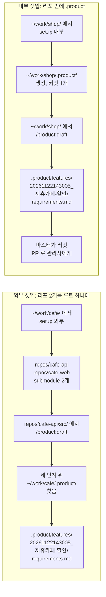

# product 셋업 방식 기획 초안

2026-11-22 · @LLM

## 필요한 결정

없음

## 도메인 언어

| 용어 | 뜻 | 예시 | 표기 |
| --- | --- | --- | --- |
| 리포지토리 외부 셋업 | "이 방식은 현재 디렉터리를 product 의 루트 디렉터리로 설정한다. 그리고, 리포지토리의 주소들을 받아, submodule로 설정한다." "혼자 product를 사용하거나, 여러 리포지토리에 걸쳐서 사용하기 위한 방법이다." | `~/work/cafe/` 에서 setup → `~/work/cafe/` 가 루트, 리포 2개가 `repos/` 아래로 | @결정 |
| 리포지토리 내부 셋업 | "이 방식은 현재 디렉터리 내부에 .product 디렉터리를 만든다. 이 리포지토리 전용 product 디렉토리로 설정하는 방식이다." | `~/work/shop/` 리포에서 setup → `~/work/shop/.product/` | @결정 |
| product 루트 | 리포지토리 외부 셋업에서 setup 을 부른 폴더. 마스터 문장의 "product 의 루트 디렉터리". 설정 파일에 적기 위해 내부 셋업에서는 `.product/` 를 만든 폴더로 넓혀 부른다 | `~/work/cafe/`, `~/work/shop/` | @해석 |
| repos | "repos 아래에 실제 리포지토리들을 둔다." product 루트 안의 폴더 | `~/work/cafe/repos/cafe-api/` | @결정 |
| 프로덕트 | "여러 외부 리포지토리들을 하나의 product skill 로 관리하는 프로덕트가 된다." product 루트 하나가 프로덕트 하나 | `~/work/cafe/` 하나가 cafe-api·cafe-web 를 묶은 프로덕트 하나 | @결정 |
| product 폴더 | 문서를 쓰는 스킬이 문서를 모으는 `.product/`. 외부 셋업은 product 루트 안, 내부 셋업은 리포 안에 둔다 | `~/work/cafe/.product/`, `~/work/shop/.product/` | @확정 (A1, 2026-11-22) |
| 기능 폴더 | product 폴더 안에서 요청 하나의 `requirements.md`·`design.md`·`tasks.md` 같은 문서를 모으는 폴더 | `.product/features/20261122143005_제휴카페-할인/` | @확정 (A4, 2026-11-22) |
| product 설정 파일 | "외부/내부인지 여부, product 루트, 각 문서들 템플릿 위치등을 저장" 하는 YAML 파일. product 폴더 옆에 `.product-settings` 라는 이름으로 둔다 | `~/work/shop/.product-settings` | @결정 (담는 것), @확정 (H6, H7, 2026-11-22) (포맷과 자리) |
| product CLI | npm 패키지 `@dorage/product` 로 배포하고 `product` 명령으로 실행하는 프로그램 | `product setup`, `product root` | @확정 (S1, H5, 2026-11-22) |

- 외부 셋업은 "product 의 루트 디렉터리", 내부 셋업은 "product 디렉토리"로 이름이 다르다. 두 방식 모두 문서는 `.product/` 에 모은다. @확정 (A1, 2026-11-22)
- 마스터 문장의 "실제 개발 리포지토리를 보는 관리자들"과 "모든 관리자"를 「참여자」 표의 "리포지토리 관리자"로 부른다. @해석
- 지금 스킬 문서는 문서가 모이는 자리를 "보관 폴더"(`~/.sdd/{리포 이름}/`)라 부른다. 새 방식에서는 "product 폴더"로 바꿔 부른다. @초안

## product 셋업 방식이란

`/product:setup` 이 product 를 기존·신규 프로젝트에 붙이는 방식을 리포지토리 외부 셋업과 리포지토리 내부 셋업 두 가지로 나누고 문서를 쓰는 스킬은 `~/.sdd/` 대신 셋업한 product 폴더에 문서를 쓴다. @해석

**참여자**

| 누구 | 하는 일 | 돈·데이터 |
| --- | --- | --- |
| product 사용자 @확정 (C2, 2026-11-22) | setup 으로 셋업 방식을 고르고, 문서를 쓰는 스킬로 기획·설계 문서를 쓴다. 외부 셋업이면 혼자 쓰거나 여러 리포를 묶는다 | 리포 주소를 setup 에 준다. 문서를 product 폴더에 쓴다 |
| 리포지토리 관리자 @확정 (C2, 2026-11-22) | 실제 개발 리포를 관리한다. 내부 셋업은 이 사람들이 모두 합의해야 쓴다 | 내부 셋업이면 `.product/` 가 든 커밋을 받는다. 외부 셋업이면 아무것도 받지 않는다 |
| product 를 설치하지 않은 팀원 @확정 (C2, 2026-11-22) | 내부 셋업한 리포를 내려받아 개발만 한다 | `.product/` 문서를 리포와 함께 받는다. 스킬 없이 마크다운으로만 읽는다 |

**정해진 원칙**

- "이제 .sdd 디렉터리를 기본으로 쓰는 행위를 더 이상하지 않을것이다." @결정
- "product:setup 시 설정방식은 2가지." 리포지토리 외부 셋업과 리포지토리 내부 셋업이다. @결정
- "그리고 이 방식은 이 product-skills를 어떻게 기존/신규 프로젝트에 결합할지에 대한 문제로 이어진다." @결정
- 외부 셋업: "이 방식을 이용하면, 실제 개발 리포지토리를 보는 관리자들은 product의 사용여부를 알 수 없다." @결정
- 외부 셋업: "다만, product의 도메인 정보가 빠르게 낡을 수 있다는 단점이 있다." @결정
- 내부 셋업: "모든 관리자가 product를 사용하기로 합의하고, 리포지토리에 .product를 업로드하는 것을 허용한 경우에 사용하는 방식이다." @결정
- 내부 셋업: "다만, product 수정사항이 리포지토리 커밋 히스토리에 섞인다는 단점이 있다." @결정

**지금 보관 폴더와의 차이**

| 구분 | 지금 (`~/.sdd/`) | 리포지토리 외부 셋업 | 리포지토리 내부 셋업 | 표기 |
| --- | --- | --- | --- | --- |
| 문서 자리 | 홈 폴더 아래 리포 이름 폴더 | product 루트 안 `.product/` | 리포 안 `.product/` | @결정 (내부), @확정 (A1, 2026-11-22) (외부) |
| 실제 리포에 파일이 생기나 | 아니오 | 아니오. 실제 리포는 repos 아래에 들어온다 | 예. `.product/` 를 커밋한다 | @결정 |
| 실제 리포의 커밋 기록 | 섞이지 않는다 | 섞이지 않는다 | 문서 커밋이 섞인다 | @결정 |
| 리포지토리 관리자가 아나 | 모른다 | 모른다 | 합의한 뒤에 쓴다 | @결정 |
| 워크트리를 지우면 | 문서가 남는다 | 문서가 남는다. product 폴더가 워크트리 밖에 있다 | 커밋하지 않은 문서는 함께 사라질 수 있다 | @확정 (B4, 2026-11-22) |
| 여러 리포에 걸친 기능 | 리포마다 따로 쌓인다 | 루트 하나에 함께 쌓인다 | 리포마다 따로 쌓인다 | @초안 |
| setup 을 부르지 않으면 | draft 가 폴더를 만든다 | 쓰지 않고 setup 을 안내한다 | 쓰지 않고 setup 을 안내한다 | @확정 (A3, 2026-11-22) |

## 문서가 쌓이는 흐름

외부 셋업은 `~/work/cafe/` 에서 setup 을 한 번 부르면 리포 2개(cafe-api, cafe-web)가 `repos/` 아래로 들어오고 그 뒤 2026-11-22 14:30:05 에 `~/work/cafe/repos/cafe-api/src/` 에서 `/product:draft` 를 불러도 문서는 세 단계 위 `~/work/cafe/.product/features/20261122143005_제휴카페-할인/requirements.md` 에 쌓인다. 내부 셋업은 `~/work/shop/` 리포 안에 `.product/` 가 생기고 setup 이 지금 브랜치에 커밋 1개를 만든다. 같은 시각에 draft 를 부르면 문서는 `~/work/shop/.product/features/20261122143005_제휴카페-할인/requirements.md` 에 쌓여 마스터가 커밋한다. @확정 (A1, A2, A4, B3, B5, 2026-11-22)

**어디서 스킬을 불러도, 위로 가장 가까운 product 폴더 한 곳에 문서가 쌓인다**

위 줄이 외부 셋업, 아래 줄이 내부 셋업이다. 두 줄 모두 마지막 상자의 경로가 문서가 실제로 쌓이는 자리다.

## 요구사항

요구사항은 6개다. 요구사항 1~3 은 마스터 설명(`.product/features/setup-method/setup-method.md`)에서, 요구사항 4 는 첫 원칙(".sdd 기본 사용 안 함")이 문서를 파일로 쓰는 8개 스킬(draft·persona-review·design·flow·task·bdd·brief-dev·brief-nondev)에 닿는 곳에서, 요구사항 5 는 setup 자동화 검토의 답(S1)에서, 요구사항 6 은 H4 답의 설정 파일에서 나왔다. 요구사항 1 인수 조건 7·8, 요구사항 2 인수 조건 10~13, 요구사항 4 인수 조건 9~14 는 참여자별 검토에서 더했다. 인수 조건 끝의 표기는 마커이고 괄호 안 ID 는 그 조건이 기대는 결정이다.

### 요구사항 1: 셋업 방식 고르기

**사용자 스토리:** product 사용자로서, setup 을 부를 때 외부·내부 셋업 중 하나를 골라서 혼자 쓰는지 관리자들과 합의했는지에 맞게 product 를 붙이고 싶다.

**인수 조건**
1. WHEN product 사용자가 `/product:setup` 을 부르면, THE System SHALL 리포지토리 외부 셋업과 리포지토리 내부 셋업 중 하나를 고르게 한다. @결정
2. WHEN 셋업 방식을 고르게 할 때, THE System SHALL 방식마다 언제 쓰는지와 단점을 「정해진 원칙」의 마스터 문장으로 함께 보여 준다. @초안
3. IF 지금 폴더에 이미 `.product/` 가 있으면, THEN THE System SHALL 새로 만들지 않고 이미 셋업했다는 것과 셋업 방식, 경로를 한 줄로 알린다. @확정 (B2, 2026-11-22)
4. WHEN 지금 폴더 위쪽에 이미 product 폴더가 있으면, THE System SHALL 그 경로를 보여 주고 그래도 여기에 셋업할지 묻는다. @확정 (A2, E1, 2026-11-22)
5. THE System SHALL 지금처럼 윤문 플러그인(`humanize-korean@im-not-ai`)이 있는지 확인하고, 없으면 설치한다. @초안
6. THE System SHALL `~/.sdd/` 폴더를 만들지 않는다. @결정
7. WHEN 이미 있는 `.product/` 의 셋업 방식을 알릴 때, THE System SHALL 설정 파일(요구사항 6)에 적힌 셋업 방식으로 알린다. @초안
8. WHEN 인수 조건 3 으로 셋업을 건너뛸 때, THE System SHALL 윤문 플러그인 확인(인수 조건 5)은 그대로 한다. @초안

인수 조건 7·8 은 이미 내부 셋업된 리포를 내려받아 product 를 처음 쓰는 사람을 위한 것이다.

**지금 동작** (@사실, origin/main 코드, 2026-11-22)
- setup 은 고르는 단계 없이 `~/.sdd/{리포 이름}/` 을 만들고 윤문 플러그인을 확인·설치한다. 리포 이름은 origin 원격 주소의 마지막 이름이다. → 인수 조건 1, 5, 6
- 폴더와 플러그인이 모두 있으면 "SDD 준비완료!" 한 줄만 답한다. → 인수 조건 3

**범위 밖:** 이미 셋업한 방식을 다른 방식으로 바꾸기 (예: 내부 셋업 리포를 외부 셋업 루트의 repos 로 옮기기)

### 요구사항 2: 리포지토리 외부 셋업

**사용자 스토리:** product 사용자로서, 지금 폴더를 product 루트로 삼고 리포 주소들을 넣어서 여러 리포에 걸친 기획을 한 곳에서 다루고 싶다. 관리자들에게 알리지 않고 혼자 써도 되게 하고 싶다.

**인수 조건**
1. WHEN 외부 셋업을 고르면, THE System SHALL 지금 폴더를 product 루트로 정한다. @결정
2. WHEN 외부 셋업을 고르면, THE System SHALL 리포 주소를 하나 이상 받는다. @결정
3. WHEN 리포 주소를 받으면, THE System SHALL 그 리포를 `repos/{리포 이름}` 에 submodule 로 더한다. @결정
4. WHEN 외부 셋업을 마치면, THE System SHALL product 루트 안에 product 폴더 `.product/` 를 만든다. @확정 (A1, 2026-11-22)
5. IF 지금 폴더가 git 리포가 아니면, THEN THE System SHALL 지금 폴더를 git 리포로 만든 뒤 submodule 을 더한다. @확정 (B1, 2026-11-22)
6. IF 지금 폴더가 다른 git 리포의 하위 폴더이면, THEN THE System SHALL 외부 셋업을 멈추고 리포 밖 폴더에서 다시 부르라고 알린다. @초안
7. IF 지금 폴더가 커밋이 있는 git 리포이고 `.product/` 가 없으면, THEN THE System SHALL 이 리포를 product 루트로 써도 되는지 한 번 묻는다. @초안
8. IF 리포 주소로 리포를 받아 오지 못하면, THEN THE System SHALL 그 리포만 건너뛰고 주소와 실패 이유를 보여 준다. @초안
9. THE System SHALL repos 아래 실제 리포에는 파일을 만들거나 고치지 않는다. @해석 ("관리자들은 product의 사용여부를 알 수 없다")
10. WHEN 외부 셋업을 마치면, THE System SHALL `.product/.gitignore` 를 만들고 커밋은 하지 않고 직접 칠 커밋 명령을 보여 준다. @확정 (F1, 2026-11-22)
11. IF 받은 리포가 하나도 없으면, THEN THE System SHALL 그래도 `.product/` 를 만들고 셋업을 마친다. @확정 (F2, 2026-11-22)
12. WHEN 일부나 모든 리포를 건너뛰고 셋업을 마치면, THE System SHALL 건너뛴 리포마다 `git submodule add {주소} repos/{리포 이름}` 명령을 보여 준다. @초안
13. WHEN 외부 셋업을 마치면, THE System SHALL 앞으로 개발은 `repos/{리포 이름}/` 에서 하라는 한 줄을 알린다. @확정 (E2, 2026-11-22)

인수 조건 7 은 개발 리포에 submodule 이 들어가면 관리자에게 보이기 때문에 묻는다. 인수 조건 12 는 B2 로 setup 을 다시 불러도 리포를 더하지 않기 때문에, 사용자가 직접 더할 명령을 남기는 것이다.

**폴더 모양** (예: `~/work/cafe/` 에 리포 2개)
| 자리 | 들어가는 것 | 표기 |
| --- | --- | --- |
| `~/work/cafe/` | product 루트. git 리포 | @결정 (루트), @확정 (B1, 2026-11-22) (git 리포) |
| `~/work/cafe/.gitmodules` | submodule 2개의 주소. 커밋은 사용자가 한다 | @확정 (F1, 2026-11-22) |
| `~/work/cafe/repos/cafe-api/` | `git@github.com:org/cafe-api.git` 의 submodule | @결정 |
| `~/work/cafe/repos/cafe-web/` | `git@github.com:org/cafe-web.git` 의 submodule | @결정 |
| `~/work/cafe/.product/` | product 폴더 | @확정 (A1, 2026-11-22) |
| `~/work/cafe/.product/.gitignore` | `_humanize/`·`_workspace/`·`.*.before` 3줄 | @확정 (F1, G1, 2026-11-22) |
| `~/work/cafe/.product-settings` | 설정 파일(YAML). 셋업 방식은 외부. 커밋은 사용자가 한다 | @확정 (H6, H7, 2026-11-22) |

**리포 이름** (예시 주소)
| 받은 주소 | repos 아래 이름 | 표기 |
| --- | --- | --- |
| `git@github.com:org/cafe-api.git` | `cafe-api` | @초안 |
| `https://github.com/org/cafe-web` | `cafe-web` | @초안 |
| 한 번의 셋업에서 `git@github.com:org/cafe-api.git` 다음에 받은 `git@github.com:other/cafe-api.git` | 두 번째 주소는 더하지 않고 이름이 겹친다고 알린다 | @초안 |

**범위 밖:**
- 셋업한 뒤에 리포 더하기. product 사용자가 submodule 을 직접 더한다 (B2)
- product 루트를 공개 원격에 올리는 위험. 회사 보안 규칙에 맡긴다 (F3)
- repos 아래 리포를 원격 최신으로 당겨 오기. 마스터가 적은 단점(도메인 정보가 빠르게 낡음)을 줄이는 일이지만 문서를 쓰는 스킬의 조사 방식까지 바뀌어서 따로 다룬다.

### 요구사항 3: 리포지토리 내부 셋업

**사용자 스토리:** product 사용자로서, 관리자들과 합의한 리포 안에 `.product/` 를 만들어서 기획 문서를 코드와 함께 리포에 올리고 싶다. 리포지토리 관리자로서, `.product/` 가 들어오는 것을 커밋 기록으로 확인하고 싶다.

**인수 조건**
1. WHEN 내부 셋업을 고르면, THE System SHALL 지금 폴더 안에 `.product/` 를 만든다. @결정
2. IF 지금 폴더가 git 리포의 맨 위 폴더가 아니면, THEN THE System SHALL 리포 맨 위와 지금 폴더 중 어디에 `.product/` 를 만들지 묻는다. @초안
3. IF 지금 폴더가 git 리포 안이 아니면, THEN THE System SHALL 내부 셋업을 멈추고 외부 셋업을 권한다. @초안
4. WHEN `.product/` 를 만들면, THE System SHALL `.product/.gitignore` 에 `_humanize/`·`_workspace/`·`.*.before` 3줄을 적는다. @확정 (G1, 2026-11-22)
5. WHEN 내부 셋업을 마치면, THE System SHALL `.product/` 를 커밋 1개로 만든다. @확정 (B3, 2026-11-22)
6. WHEN 셋업 커밋을 만들 때, THE System SHALL 새 브랜치를 만들지 않고 지금 브랜치에 정해진 메시지로 커밋한다. @확정 (B5, 2026-11-22)
7. WHEN 커밋을 만들 때, THE System SHALL `.product/` 아래 파일과 `.product-settings` 만 커밋에 담는다. @확정 (H7, 2026-11-22)
8. WHEN 커밋을 마치면, THE System SHALL push 와 PR 은 하지 않고 직접 칠 push 명령을 보여 준다. @확정 (B6, 2026-11-22)
9. IF 커밋이 실패하면, THEN THE System SHALL `.product/` 는 남기고 실패 이유와 직접 칠 커밋 명령을 보여 준다. @초안

인수 조건 7 은 사용자가 미리 커밋 대상으로 올려 둔 다른 변경이 셋업 커밋에 섞이지 않게 하려는 것이다.

**폴더 모양** (예: `~/work/shop/` 리포)
| 자리 | 들어가는 것 | 표기 |
| --- | --- | --- |
| `~/work/shop/` | 관리자들이 합의한 실제 개발 리포 | @결정 |
| `~/work/shop/.product/` | product 폴더. 리포에 커밋한다 | @결정 |
| `~/work/shop/.product/.gitignore` | `_humanize/`·`_workspace/`·`.*.before` 3줄 | @확정 (G1, 2026-11-22) |
| `~/work/shop/.product-settings` | 설정 파일(YAML). 셋업 방식은 내부. 리포에 커밋한다 | @확정 (H6, H7, 2026-11-22) |
| `~/work/shop/.product/features/20261122143005_제휴카페-할인/` | 기능 폴더 | @확정 (A4, 2026-11-22) |

**커밋** (예: `~/work/shop/` 의 main 에서 내부 셋업)
| 항목 | 값 | 표기 |
| --- | --- | --- |
| 커밋 수 | 1개 | @확정 (B3, 2026-11-22) |
| 브랜치 | 지금 브랜치 그대로. main 에서 부르면 main 에 커밋한다 | @확정 (B5, 2026-11-22) |
| 커밋 메시지 | `chore:product 폴더 추가` | @초안 (메시지 글자), @확정 (B5, 2026-11-22) (정해진 메시지 하나) |
| 담는 파일 | `.product/.gitignore` 와 `.product-settings` 2개. README 는 만들지 않는다. git 은 빈 폴더를 담지 않아서 `.gitignore` 가 `.product/` 를 리포에 남긴다 | @확정 (D1, H7, 2026-11-22) |

**범위 밖:**
- 관리자들의 합의를 받는 절차. 스킬 밖에서 사람끼리 하는 일이다.
- 기능 문서를 리포에 올리고 고치는 팀 규칙. 각 팀이 정한다 (D2)
- `.product/` 를 설명하는 README. setup 은 README 를 만들지 않는다 (D1)
- 셋업을 거두거나 product 를 그만두기. 사람이 직접 지운다 (G2)

### 요구사항 4: 문서를 쓰는 스킬이 product 폴더 찾기

**사용자 스토리:** product 사용자로서, 어느 폴더에서 스킬을 부르든 셋업한 product 폴더에 문서가 쌓여서 한 기능의 문서를 한곳에서 찾고 싶다.

**인수 조건**
1. THE System SHALL `~/.sdd/` 를 기본 저장 위치로 쓰지 않는다. @결정
2. WHEN 문서를 쓰는 스킬이 저장 위치를 정할 때, THE System SHALL 지금 폴더에서 위로 올라가며 가장 가까운 product 폴더를 찾는다. @확정 (A2, 2026-11-22)
3. IF 위로 올라가도 product 폴더가 없으면, THEN THE System SHALL 문서를 쓰지 않고 `/product:setup` 을 먼저 부르라고 알린다. @확정 (A3, 2026-11-22)
4. WHEN `/product:draft` 가 새 요청을 받으면, THE System SHALL product 폴더의 `features/` 아래에 기능 폴더를 새로 만든다. @확정 (A4, 2026-11-22)
5. WHEN draft 가 아닌 스킬이 경로 없이 불리면, THE System SHALL `features/` 아래 기능 폴더를 이름 앞 시각이 최근인 순서로 4개까지 보여 주고 고르게 한다. @확정 (A4, 2026-11-22)
6. WHEN product 사용자가 경로를 주면, THE System SHALL product 폴더를 찾지 않고 그 경로에 쓴다. @초안
7. WHILE 워크트리 안에서 스킬을 부르는 동안, THE System SHALL 그 워크트리 안의 product 폴더를 먼저 찾는다. @확정 (B4, 2026-11-22)
8. THE System SHALL 이미 `~/.sdd/` 에 있는 문서를 옮기거나 지우지 않는다. @확정 (C1, 2026-11-22)
9. WHEN 기능 폴더를 고르게 할 때 `~/.sdd/{리포 이름}/` 이 있으면, THE System SHALL 그 경로와 "예전 기능은 경로를 주면 이어 쓴다" 를 한 줄로 함께 알린다. @초안
10. IF 받은 경로가 repos 아래 실제 리포 안이면, THEN THE System SHALL 쓰기 전에 실제 리포 안이라 관리자에게 보일 수 있다는 한 줄을 알린다. @확정 (F4, 2026-11-22)
11. WHILE 내부 셋업 product 폴더에 쓰는 동안, THE System SHALL 개인 설정이나 이 컴퓨터에서 확인한 사실은 문서에 쓰지 않고 채팅에만 남긴다. @확정 (D3, 2026-11-22)
12. WHEN 윤문을 부를 때, THE System SHALL 기능 폴더를 지금 폴더로 삼아 작업 파일이 product 폴더 안에만 생기게 한다. @확정 (G1, 2026-11-22)
13. WHEN 내부 셋업 product 폴더의 문서에 마스터 답을 기록할 때, THE System SHALL 답 옆에 답한 사람의 git `user.name` 을 함께 적는다. @확정 (D4, 2026-11-22)
14. IF git `user.name` 이 설정되어 있지 않으면, THEN THE System SHALL 답 옆에 "이름 없음" 을 적고 끝맺음에 설정 명령을 알린다. @초안 (D4)

인수 조건 9 는 C1 으로 남긴 예전 문서를 사용자가 잃어버린 것으로 여기지 않게 하려는 것이다.

**어디서 부르면 어느 product 폴더를 찾나** (「문서가 쌓이는 흐름」의 두 프로덕트)
| 부른 자리 | 찾는 product 폴더 | 표기 |
| --- | --- | --- |
| `~/work/cafe/` | `~/work/cafe/.product/` | @확정 (A1, A2, 2026-11-22) |
| `~/work/cafe/repos/cafe-api/src/` | 세 단계 위 `~/work/cafe/.product/` | @확정 (A2, 2026-11-22) |
| `~/work/cafe/repos/cafe-api/` (이 리포도 내부 셋업을 했을 때) | 더 가까운 `~/work/cafe/repos/cafe-api/.product/` | @확정 (A2, 2026-11-22) |
| `~/work/shop/packages/api/` (리포 맨 위와 여기 둘 다 내부 셋업을 했을 때) | 더 가까운 `~/work/shop/packages/api/.product/` | @확정 (A2, E1, 2026-11-22) |
| `~/work/shop/` | `~/work/shop/.product/` | @확정 (A2, 2026-11-22) |
| `~/work/shop/.worktrees/feat-x/` (내부 셋업 커밋 뒤에 만든 워크트리) | `~/work/shop/.worktrees/feat-x/.product/` | @확정 (B4, 2026-11-22) |
| `~/work/shop/.worktrees/feat-x/` (내부 셋업보다 먼저 만든 워크트리) | 두 단계 위 메인 체크아웃의 `~/work/shop/.product/` | @초안 (A2 를 따른 결과) |
| `~/work/other/` (셋업 안 함) | 없음 → 인수 조건 3 | @확정 (A3, 2026-11-22) |

**기능 폴더 이름** (예: 2026-11-22 14:30:05 에 "제휴 카페 임직원 할인" 요청, `~/work/shop/` 내부 셋업)
| 항목 | 값 | 표기 |
| --- | --- | --- |
| 지금 (AS-IS) | `~/.sdd/shop/20261122143005_제휴카페-임직원-할인/` | @사실 (origin/main 코드, 2026-11-22) |
| 새 기능 폴더 | `~/work/shop/.product/features/20261122143005_제휴카페-임직원-할인/` | @확정 (A4, 2026-11-22) |
| `{시각}` 과 `{요청내용}` 을 만드는 법 | 지금 규칙 그대로 (폴더를 만드는 순간의 로컬 시각, 설명을 줄인 50자 이내 한국어) | @초안 |
| 같은 이름이 이미 있을 때 | 1초 뒤 시각으로 다시 만든다 (지금 규칙 그대로) | @초안 |

**지금 동작** (@사실, origin/main 코드, 2026-11-22)
- 문서를 쓰는 스킬은 `~/.sdd/{리포 이름}/{시각}_{요청내용}/` 에 쓴다. 리포를 더럽히지 않고 워크트리를 지워도 문서가 남게 하려는 자리다. → 인수 조건 1, 7
- setup 을 부르지 않아도 draft 가 `~/.sdd/{리포 이름}/` 을 만든다. → 인수 조건 3
- draft 가 아닌 스킬은 경로가 없으면 `~/.sdd/{리포 이름}/` 의 폴더를 최신순 4개로 보여 주고 고르게 한다. → 인수 조건 5
- 설명에 경로가 있으면 그 경로에 쓴다. → 인수 조건 6
- 윤문 작업 파일은 지금 폴더 아래 `_workspace/` 에 생겼다가 기능 폴더 `_humanize/` 로 옮겨지고, 보존 검사가 DIFF 면 원본 사본 `.{파일 이름}.before` 가 기능 폴더에 남는다. → 인수 조건 12, 요구사항 3 인수 조건 4

**범위 밖:**
- `/product:quick`. 파일을 쓰지 않는 채팅 답이라 product 폴더를 찾지 않는다.
- 다른 사용자가 먼저 고친 문서와의 충돌. git 충돌로 사람이 푼다 (D5)

### 요구사항 5: product CLI 설치와 실행

setup 자동화 검토에 마스터가 답해서 생긴 요구사항이다 (S1).

**사용자 스토리:** product 사용자로서, setup 을 부르면 npm 으로 배포된 product CLI 가 설치되어서 셋업 단계를 같은 프로그램으로 매번 똑같이 돌리고 싶다. Claude 밖의 터미널에서도 같은 셋업을 하고 싶다.

**인수 조건**
1. WHEN product 사용자가 `/product:setup` 을 부르면, THE System SHALL npm 에서 product CLI 를 설치한다. @확정 (S1, 2026-11-22)
2. WHEN CLI 를 설치하면, THE System SHALL 요구사항 1~3 의 셋업 단계를 CLI 로 실행한다. @확정 (S1, 2026-11-22)
3. IF 맞는 버전의 CLI 가 이미 있으면, THEN THE System SHALL 다시 설치하지 않는다. @확정 (H3, 2026-11-22)
4. IF npm 이 없으면, THEN THE System SHALL CLI 를 설치하지 않고 스킬이 셸 명령으로 요구사항 1~3 과 요구사항 6 의 셋업을 대신한다. @확정 (H2, 2026-11-22)
5. IF CLI 설치가 실패하면, THEN THE System SHALL 실패 이유와 직접 칠 설치 명령을 보여 준다. @초안
6. WHEN 스킬 안에서 CLI 를 실행할 때, THE System SHALL 질문은 스킬이 하고 답을 CLI 옵션으로 넘긴다. @확정 (H1, 2026-11-22)
7. WHEN 사용자가 터미널에서 옵션 없이 CLI 를 실행하면, THE System SHALL CLI 가 빠진 답을 직접 묻는다. @확정 (H1, 2026-11-22)
8. IF 설치된 CLI 버전이 플러그인이 기대하는 버전보다 낮으면, THEN THE System SHALL setup 이 맞는 버전으로 다시 설치한다. @확정 (H3, 2026-11-22)
9. WHEN CLI 가 있으면, THE System SHALL 문서를 쓰는 스킬은 CLI 로 product 폴더를 찾는다. @확정 (H4, 2026-11-22)
10. WHILE CLI 가 없는 동안, THE System SHALL 문서를 쓰는 스킬은 문서를 쓰지 않고 CLI 가 없다는 것과 node 를 설치한 뒤 `/product:setup` 을 다시 부르라는 안내를 보여 준다. @확정 (H9, 2026-11-22)
11. IF 문서를 쓰는 스킬이 부른 CLI 의 버전이 플러그인이 기대하는 버전보다 낮으면, THEN THE System SHALL 문서를 쓰지 않고 `/product:setup` 을 다시 부르라고 알린다. @확정 (H3, 2026-11-22)

인수 조건 5 는 npm 전역 설치가 권한 오류로 실패하는 컴퓨터가 있기 때문에 둔다. 인수 조건 4 때문에 셋업이 CLI 와 스킬 두 곳에 생긴다. 두 곳은 같은 설정 파일(요구사항 6)을 쓴다. product 폴더 찾기는 CLI 한 곳에만 있다 (인수 조건 9·10).

**설치** (H5)
| 항목 | 값 | 표기 |
| --- | --- | --- |
| 설치 명령 | `npm i -g @dorage/product` | @확정 (H5, 2026-11-22) |
| 실행 명령 | `product`. 하위 명령 예: `product setup`, `product root` | @확정 (H5, 2026-11-22) (명령 이름), @초안 (하위 명령) |
| 명령 이름이 겹치는지 | `product` 가 다른 프로그램 이름과 겹치는지는 다른 컴퓨터에서 확인하지 않았다 | @가정 |
| 설치 범위 | 컴퓨터 전체(전역). 리포마다 따로 설치하지 않는다 | @해석 ("setup과정에서는 이 cli를 설치") |
| 버전 | 플러그인이 기대하는 CLI 버전과 같아야 한다 | @확정 (H3, 2026-11-22) |

**지금 동작** (@사실, origin/main 코드, 2026-11-22)
- 이 리포에는 npm 패키지가 없다. 스크립트는 `npx tsx` 로 돌리는 평가 스크립트뿐이고, node 기본 기능만 쓴다. → 인수 조건 1
- setup 은 지금도 윤문 플러그인을 자동으로 설치한다. → 인수 조건 1 (같은 모양으로 CLI 를 설치)

**범위 밖:** npm 배포 과정(배포 계정 관리, 자동 배포). 설계와 구현 계획에서 다룬다.

### 요구사항 6: product 설정 파일

H4 답에서 마스터가 설정 파일을 두자고 해서 생긴 요구사항이다.

**사용자 스토리:** product 사용자로서, 셋업한 방식과 product 루트, 문서 템플릿 위치를 설정 파일 하나에 남겨서 CLI 와 스킬이 같은 정보를 읽게 하고 싶다.

**인수 조건**
1. WHEN 셋업을 마치면, THE System SHALL product 폴더 옆에 `.product-settings` 를 만든다. @확정 (H7, 2026-11-22)
2. THE System SHALL 설정 파일에 셋업 방식(외부·내부), product 루트, 문서 템플릿 위치를 적는다. @결정
3. THE System SHALL product 루트를 절대 경로가 아니라 설정 파일이 있는 자리를 기준으로 적는다. @초안
4. WHEN CLI 가 product 폴더를 찾으면, THE System SHALL 그 옆의 `.product-settings` 를 읽어 셋업 방식과 product 루트를 정한다. @초안
5. IF 찾은 product 폴더 옆에 설정 파일이 없거나 읽을 수 없으면, THEN THE System SHALL 문서를 쓰지 않고 어느 파일이 왜 문제인지와 `/product:setup` 을 알린다. @초안
6. THE System SHALL 설정 파일에 문서 템플릿 위치를 적을 자리를 두되, 이번 작업에서는 비워 둔다. @확정 (H8, 2026-11-22)
7. IF `.product/` 는 있는데 `.product-settings` 가 없을 때 setup 을 부르면, THEN THE System SHALL 셋업 방식만 물어 설정 파일을 만든다. @확정 (H10, 2026-11-22)
8. THE System SHALL 설정 파일을 YAML 로 쓴다. @확정 (H6, 2026-11-22)

인수 조건 3 은 내부 셋업이면 설정 파일을 리포에 커밋하는데, 팀원마다 리포를 받은 자리가 달라 절대 경로가 맞지 않기 때문이다. 인수 조건 5 는 손으로 고치다 깨진 설정 파일을 위한 것이다. 인수 조건 7 은 요구사항 1 인수 조건 3(B2, 이미 셋업했으면 알리고 끝냄)의 예외다.

**설정 파일 내용** (「문서가 쌓이는 흐름」의 두 프로덕트)
| 항목 | 외부 셋업 | 내부 셋업 | 표기 |
| --- | --- | --- | --- |
| 파일 자리 | `~/work/cafe/.product-settings` | `~/work/shop/.product-settings` | @확정 (H7, 2026-11-22) |
| 셋업 방식 | `mode: external` | `mode: internal` | @결정 |
| product 루트 | `root: .` (설정 파일이 있는 폴더, `~/work/cafe/`) | `root: .` (`~/work/shop/`) | @초안 |
| 문서 템플릿 위치 | `templates: {}` | `templates: {}` | @확정 (H8, 2026-11-22) |
| product 폴더 이름 | 적지 않음. 적으면 `productDirName: specs` 처럼 설정 파일 옆 폴더 이름 하나, 없으면 `.product` | 같음 | 기본값은 @결정 (2026-11-26 "settings에 명시되어 있지 않다면, 기본은 .product"), 키 이름은 @확정 (A1, 2026-11-26 "A1. productDirName 으로 변경. directory가 아니라 이름이 중요한 경우라서."), 경로를 막는 규칙은 @해석 (A1) |

**지금 동작** (@사실, origin/main 코드, 2026-11-22)
- 셋업 방식이나 루트를 적어 두는 파일이 없다. 스킬마다 `~/.sdd/{리포 이름}/` 을 직접 정한다. → 인수 조건 1, 4

**범위 밖:** 템플릿으로 문서 모양을 바꾸기. 별개 작업으로 한다 (H8)

## 결정 기록 (2026-11-22)

문서에 반영한 뜻이 답을 풀어 쓴 것이면 @해석 으로 둡니다.

| ID | 질문 | 마스터 답 | 문서에 반영한 뜻 | 표기 |
| --- | --- | --- | --- | --- |
| A1 | 외부 셋업에도 product 루트 안에 `.product/` 를 둘지 | "A1. a안." | 두 방식 모두 문서는 `.product/` 에 모은다 (도메인 언어 product 폴더, 요구사항 2 인수 조건 4) | @확정 |
| A2 | 스킬이 product 폴더를 찾는 방법 | "A2. a안." | 지금 폴더에서 위로 올라가며 가장 가까운 `.product/` (요구사항 1 인수 조건 4, 요구사항 4 인수 조건 2) | @확정 |
| A3 | product 폴더를 못 찾았을 때 | "A3. a안." | 쓰지 않고 `/product:setup` 을 안내한다 (요구사항 4 인수 조건 3) | @확정 |
| A4 | 기능 폴더 이름 모양 | "A4. b안." | `features/{시각}_{요청내용}/` (요구사항 4 인수 조건 4·5, 요구사항 4 기능 폴더 이름) | @확정 |
| B1 | 외부 셋업 폴더가 git 리포가 아닐 때 | "B1. a안." | setup 이 git 리포로 만든다 (요구사항 2 인수 조건 5) | @확정 |
| B2 | 셋업한 곳에서 setup 을 다시 부를 때 | "B2. b안." | 이미 셋업했다고 알리고 끝낸다. 리포는 사용자가 직접 더한다 (요구사항 1 인수 조건 3, 요구사항 2 범위 밖) | @확정 |
| B3 | 내부 셋업 `.product/` 를 누가 커밋할지 | "B3. b안." | setup 이 커밋 1개를 만든다 (요구사항 3 인수 조건 5, 요구사항 3 커밋) | @확정 |
| B4 | 워크트리에서 어느 `.product/` 에 쓸지 | "B4. a안." | 지금 워크트리의 `.product/` (요구사항 4 인수 조건 7) | @확정 |
| B5 | 내부 셋업 커밋의 브랜치와 이름 | "B5. a안." | 지금 브랜치에 정해진 메시지로 커밋한다 (요구사항 3 인수 조건 6, 요구사항 3 커밋) | @확정 |
| B6 | 커밋 뒤 push 와 PR 까지 할지 | "B6. a안." | 커밋까지만 하고 push 명령을 보여 준다 (요구사항 3 인수 조건 8) | @확정 |
| B7 | 새 브랜치에 커밋한 뒤 어느 브랜치에 남을지 | "B7. a안." | 커밋한 브랜치에 남는다. B5 로 새 브랜치가 생기지 않아 바꿀 곳이 없다 | @해석 |
| B8 | 셋업 브랜치가 이미 있을 때 | "B8. 신경쓰지 않는다." | 따로 다루지 않는다. B5 로 셋업 브랜치가 생기지 않는다 | @해석 |
| C1 | 이미 `~/.sdd/` 에 있는 문서 | "C1. a안." | 그대로 둔다 (요구사항 4 인수 조건 8) | @확정 |
| C2 | 참여자 목록 | "C2. a안." | 세 참여자 그대로 (「참여자」 표) | @확정 |
| D1 | `.product/README.md` 를 함께 만들지 | "D1. b안." | `.gitignore` 만 만든다 (요구사항 3 커밋, 요구사항 3 범위 밖) | @확정 |
| D2 | 기능 문서를 리포에 올리고 고치는 팀 규칙 | "D2. 팀에서 알아서" | 스킬은 정하지 않고 각 팀이 정한다 (요구사항 3 범위 밖) | @해석 |
| D3 | 개인 설정·이 컴퓨터의 사실을 어떻게 다룰지 | "D3. a안." | 내부 셋업 문서에는 쓰지 않고 채팅에만 남긴다 (요구사항 4 인수 조건 11) | @확정 |
| D4 | 결정 기록의 답한 사람 | "D4. a안." | 답 옆에 git `user.name` 을 적는다 (요구사항 4 인수 조건 13) | @확정 |
| D5 | 다른 사용자가 먼저 고친 문서 | "D5. a안." | git 충돌로 사람이 푼다 (요구사항 4 범위 밖) | @확정 |
| E1 | 같은 리포 하위 폴더에서 내부 셋업 | "E1. b안." | 묻고 만든다 (요구사항 1 인수 조건 4) | @확정 |
| E2 | 이미 받아 둔 리포를 외부 셋업에 묶을 때 | "E2. a안." | 마칠 때 개발 자리를 알린다 (요구사항 2 인수 조건 13) | @확정 |
| F1 | 외부 셋업 결과를 커밋할지 | "F1. b안." | `.gitignore` 만 만들고 커밋 명령을 보여 준다 (요구사항 2 인수 조건 10) | @확정 |
| F2 | 외부 셋업에서 리포를 하나도 못 받았을 때 | "F2. b안." | 그래도 `.product/` 를 만든다 (요구사항 2 인수 조건 11) | @확정 |
| F3 | 공개 원격 경고 | "F3. b안." | 회사 보안 규칙에 맡긴다 (요구사항 2 범위 밖) | @확정 |
| F4 | 준 경로가 실제 리포 안일 때 | "F4. a안." | 쓰고 한 줄 알린다 (요구사항 4 인수 조건 10) | @확정 |
| G1 | 윤문 작업 파일이 새지 않게 | "G1. a안." | 기능 폴더에서 윤문을 부르고 `.gitignore` 3줄로 막는다 (요구사항 3 인수 조건 4, 요구사항 4 인수 조건 12) | @확정 |
| G2 | 그만두거나 셋업 PR 이 거절됐을 때 | "G2. a안." | 범위 밖, 사람이 지운다 (요구사항 3 범위 밖) | @확정 |
| S1 | setup 을 무엇으로 자동화할지 (채팅에서 물음) | "S1. b안. cli를 npm으로 배포해서, setup과정에서는 이 cli를 설치하는걸로 가면 좋을것 같아요잉." | npm 으로 따로 배포한 CLI 를 setup 이 설치하고, 셋업 단계는 CLI 가 돌린다 (요구사항 5 인수 조건 1·2) | @확정 |
| H1 | 셋업 질문을 누가 할지 | "H1. c안." | 스킬 안에서는 스킬이 묻고 옵션으로 넘기고, 터미널에서는 CLI 가 빠진 답을 묻는다 (요구사항 5 인수 조건 6·7) | @확정 |
| H2 | npm 이 없을 때 | "H2. b안." | 스킬이 셸 명령으로 셋업을 대신한다 (요구사항 5 인수 조건 4) | @확정 |
| H3 | CLI 버전이 플러그인과 맞지 않을 때 | "H3. a안." | setup 이 맞는 버전으로 다시 설치하고, 다른 스킬은 setup 을 안내한다 (요구사항 5 인수 조건 3·8·11) | @확정 |
| H4 | 8개 스킬도 CLI 로 product 폴더를 찾을지 | "H4. a안. 그래서 이걸 위해서, .product-settings 파일을 추가하는걸 생각중이야. 근데 포맷은 뭘로할지 아직 고민중. 이걸로 외부/내부인지 여부, product 루트, 각 문서들 템플릿 위치등을 저장" | CLI 로 찾는다 (요구사항 5 인수 조건 9). 설정 파일을 둔다 (요구사항 6, 포맷은 H6) | @확정 (CLI 로 찾기), @해석 (설정 파일) |
| H5 | npm 패키지 이름과 명령 이름 | "H5. @dorage/product 인데, cli 명령어는 product로 가면 좋을듯" | 패키지 `@dorage/product`, 명령 `product` (요구사항 5 설치) | @확정 |
| H6 | 설정 파일 포맷 | "H6. b안." | YAML (요구사항 6 인수 조건 8, 요구사항 6 설정 파일 내용) | @확정 |
| H7 | 설정 파일 자리 | "H7. a안." | product 폴더 옆 `.product-settings` (요구사항 6 인수 조건 1, 요구사항 3 인수 조건 7) | @확정 |
| H8 | 템플릿 위치로 이번에 할 일 | "H8. c안." | 자리만 비워 두고 템플릿 바꾸기는 별개 작업 (요구사항 6 인수 조건 6, 요구사항 6 범위 밖) | @확정 |
| H9 | npm 없는 컴퓨터에서 문서를 쓰는 스킬 | "H9. b안." | 문서를 쓰지 않고 CLI 가 없다고 알린다 (요구사항 5 인수 조건 10) | @확정 |
| H10 | `.product/` 는 있는데 설정 파일이 없을 때 | "H10. a안." | setup 이 셋업 방식만 물어 설정 파일을 만든다 (요구사항 6 인수 조건 7) | @확정 |

## 기존 시스템과 맞닿는 곳

윤문 플러그인 준비와 문서 포맷(결정·마커·답 반영)은 그대로 쓰고 setup 의 폴더 만들기와 문서를 쓰는 스킬의 저장 위치·폴더 고르기 규칙은 새로 만든다. 결정 기록에 답한 사람을 적는 것(요구사항 4 인수 조건 13)은 문서 포맷에 더하는 것이다.

| 기존 기능 | 지금 동작 | product 셋업 방식과의 관계 | 표기 |
| --- | --- | --- | --- |
| npm 패키지 | 요구사항 5 지금 동작 | CLI 패키지와 배포를 새로 만든다 → 요구사항 5 | @사실 (origin/main 코드, 2026-11-22) |
| 스펙 보관 폴더 준비 (setup) | 요구사항 1 지금 동작 | 요구사항 1~3 이 폴더 만들기를 대신한다. 윤문 플러그인 확인은 그대로 둔다 | @사실 (origin/main 코드, 2026-11-22) |
| 저장 위치와 폴더 고르기 | 요구사항 4 지금 동작 | 요구사항 4 가 대신한다 | @사실 (origin/main 코드, 2026-11-22) |
| 윤문 작업 파일 치우기 | 요구사항 4 지금 동작 | 요구사항 3 인수 조건 4 와 요구사항 4 인수 조건 12 로 바뀐다 | @사실 (origin/main 코드, 2026-11-22) |
| 문서 모양 | 단계마다 결과물 모양이 플러그인 안 `references/{스킬 이름}.md` 에 있다 | 설정 파일의 템플릿 위치가 이 자리를 바꿀 수 있게 된다 → H8 | @사실 (origin/main 코드, 2026-11-22) |
| 결정 기록 표 | 마스터 답 원문만 적는다 | 내부 셋업이면 답한 사람을 더한다 → 요구사항 4 인수 조건 13 | @사실 (origin/main 코드, 2026-11-22) |
| 스킬 안내 문장의 예시 경로 | 스킬 설명과 참고 문서 곳곳의 예시가 `~/.sdd/dotfiles/20261102143005_제휴카페-임직원-할인/` 모양이다 | 요구사항 4 「기능 폴더 이름」 모양으로 모두 바꿔야 한다 | @사실 (origin/main 코드, 2026-11-22) |
| 예전 sdd 플러그인 (`sdd@dotfiles`) | 이 컴퓨터에 아직 켜져 있고 `~/.sdd/` 에 쓴다 | 새 규칙이 들어가도 예전 플러그인으로 부르면 계속 `~/.sdd/` 에 쌓인다 | @사실 (로컬 플러그인 설정, 2026-11-22) |
| 워크트리 위치 | 마스터 전역 지시가 워크트리를 리포 안 `./.worktrees` 에 둔다 | 위로 올라가며 찾으면(A2) 워크트리 밖 메인 체크아웃의 `.product/` 까지 닿는다 → 요구사항 4 업무 규칙 | @사실 (마스터 전역 지시, 2026-11-22) |

**구현 전에 확인할 것**
- 마스터가 설명 파일을 기능 폴더 안(`.product/features/setup-method/setup-method.md`)으로 옮겼다. 기능 폴더 안에 설명 원문을 두는 것이 앞으로의 모양이면 draft 가 설명 원문을 기능 폴더에 남기는 규칙이 더 필요하고, 이번 한 번만 옮긴 것이면 바꿀 것이 없다. @가정
- 스킬이 셸 명령을 세션을 연 폴더에서 실행하면 A2 의 "지금 폴더"는 세션 폴더이고 스킬이 다른 폴더로 옮겨 실행하면 찾는 결과가 그 폴더 기준으로 바뀐다. @가정
- repos 아래로 받을 리포가 비공개일 때, 마스터의 git 인증으로 받아지면 바꿀 것이 없고 받아지지 않으면 요구사항 2 인수 조건 8 로 건너뛴다. @가정

**별개 작업**
- 외부 셋업에서 문서를 쓰는 스킬의 조사(`git fetch` 뒤 `origin/main` 기준으로 읽기)를 repos 아래 여러 리포에 걸쳐 하는 방법
- 워크트리를 지우기 전에 커밋하지 않은 `.product/` 문서가 있는지 확인하기 (B4 의 위험, wt 플러그인 쪽 일)
- 내부 셋업 리포의 테스트·검사 도구 설정에서 `.product/` 빼기 (리포지토리 관리자 일. 예: `**/*.feature` 를 찾는 테스트 도구가 bdd 결과물을 집는 경우)
- 이 컴퓨터의 `sdd@dotfiles` 를 지우고 `product@product-skills` 로 바꾸기

## 참여자별 검토 기록

LLM 이 검토를 다시 돌릴 때 쓰는 기록입니다.

- product 사용자
    - 셋업 커밋 뒤 어느 브랜치에서 이어 쓰나 → B7
    - 셋업 PR 머지 전에 setup 을 다시 부른다 → B8 (리포지토리 관리자와 함께 찾음)
    - 기능 문서를 커밋해 PR 로 올린다 → D2, 요구사항 3 범위 밖 (리포지토리 관리자·product 를 설치하지 않은 팀원과 함께 찾음)
    - 윤문 작업 파일이 실제 리포에 남지 않게 한다 → G1, 요구사항 4 인수 조건 12 (product 를 설치하지 않은 팀원과 함께 찾음)
    - 준 경로가 repos 아래 실제 리포 안이다 → F4, 요구사항 4 인수 조건 10
    - 개인 설정과 이 컴퓨터의 사실이 문서에 들어간다 → D3, 요구사항 4 인수 조건 11 (리포지토리 관리자와 함께 찾음)
    - 외부 셋업 결과를 product 루트에 커밋한다 → F1, 요구사항 2 인수 조건 10
    - 받지 못한 리포를 다시 더한다 → F2, 요구사항 2 인수 조건 11·12
    - 이미 받아 둔 리포를 외부 셋업에 묶는다 → E2, 요구사항 2 인수 조건 13
    - 셋업 방식을 고를 때 단점을 본다 → 「정해진 원칙」, 요구사항 1 인수 조건 2 (product 를 설치하지 않은 팀원과 함께 찾음)
    - `~/.sdd/` 에서 하던 기능을 이어 쓴다 → 요구사항 4 인수 조건 9
    - 같은 문서를 다른 사용자가 먼저 고쳤다 → D5, 요구사항 4 범위 밖
    - product 를 그만 쓰거나 셋업을 거둔다 → G2, 요구사항 3 범위 밖 (리포지토리 관리자·product 를 설치하지 않은 팀원과 함께 찾음)
    - 쓰기 전에 경로를 본다 → 이미 있던 자리 (공용 포맷 「저장 위치」)
    - 고를 기능 폴더가 0개일 때 안내를 받는다 → 이미 있던 자리 (공용 포맷 「저장 위치」)
- 리포지토리 관리자
    - 셋업 PR 을 보고 무엇을 허락하는지 안다 → D1, 요구사항 3 범위 밖 (product 를 설치하지 않은 팀원과 함께 찾음)
    - 리포에 올라오는 문서에서 개인 환경 정보를 거른다 → D3 (product 사용자와 함께 찾음)
    - 셋업 PR 을 거절한다 → G2 (product 사용자와 함께 찾음)
    - 리포에서 product 사용을 그만둔다 → G2 (product 사용자·product 를 설치하지 않은 팀원과 함께 찾음)
    - 기획 문서가 담긴 PR 을 받는 규칙을 정한다 → D2 (product 사용자·product 를 설치하지 않은 팀원과 함께 찾음)
    - 결정 기록에서 누가 결정했는지 본다 → D4, 요구사항 4 인수 조건 13·14
    - 한 리포에 `.product/` 를 하나 더 만드는 PR 을 받는다 → E1, 요구사항 1 인수 조건 4
    - 두 사람이 따로 만든 셋업 PR 을 받는다 → B8 (product 사용자와 함께 찾음)
    - 셋업 커밋이 리포의 브랜치·커밋 규칙에 맞는지 본다 → B5, 요구사항 3 인수 조건 6
    - 외부 셋업에서 내 리포 내용이 어디로 가는지 안다 → F3, 요구사항 2 범위 밖
- product 를 설치하지 않은 팀원
    - 정해진 규칙만 골라 읽는다 → D1, D2
    - `.product/` 가 무엇인지 처음 안다 → D1 (리포지토리 관리자와 함께 찾음)
    - 맡은 기능의 문서를 리포에서 받는다 → D2 (product 사용자·리포지토리 관리자와 함께 찾음)
    - 커밋 기록에서 코드 변경만 골라 본다 → 「정해진 원칙」, D2 (product 사용자와 함께 찾음)
    - 이미 내부 셋업된 리포에서 product 를 새로 쓰기 시작한다 → 요구사항 1 인수 조건 7·8
    - 윤문 작업 파일 없이 문서만 받는다 → G1 (product 사용자와 함께 찾음)
    - 문서가 틀렸거나 코드와 달라졌을 때 고친다 → D2
    - 팀이 그만둔 뒤 남은 `.product/` 를 처리한다 → G2 (product 사용자·리포지토리 관리자와 함께 찾음)
    - 테스트·검사 도구가 `.product/` 를 집지 않는다 → 별개 작업
