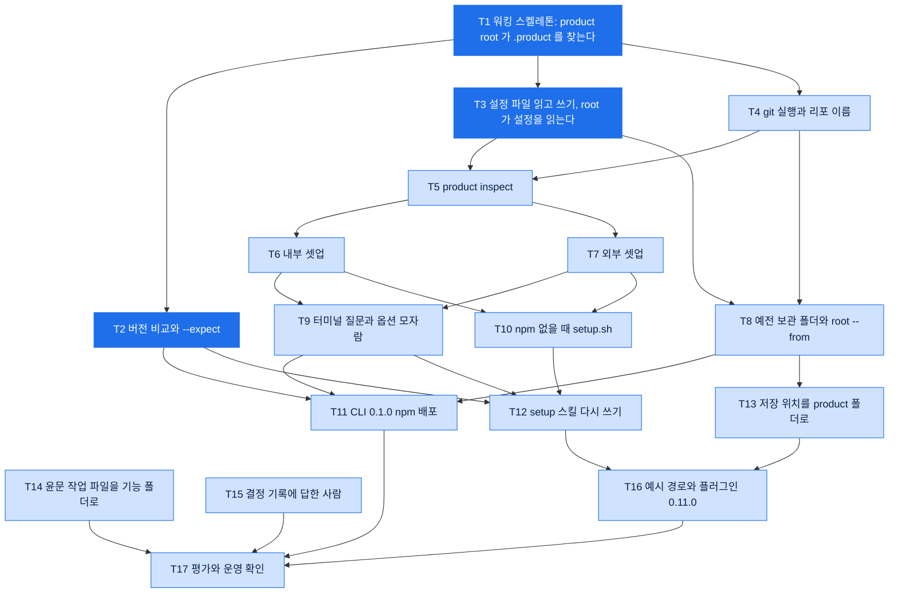

# product 셋업 방식 구현 계획

기준: `requirements.md`, `design.md` (origin/main 1d69223)

## 작업 DAG

> 진행 규칙: 작업 하나를 끝내 커밋하면, 그 노드를 `todo` 줄에서 `done` 줄로 옮기고 그 작업의 체크박스를 체크한다. 노드가 0개가 된 `class` 줄은 지운다. 화살표로 이어지지 않은 작업은 동시에 진행해도 된다.

## 작업

### T1 워킹 스켈레톤: product root 가 .product 를 찾는다

- [x] 완료
- 선행: 없음
- 가리키는 곳: design.md 컴포넌트 `packages/cli/` 패키지, `cli.ts`, `find.ts`, 리포 `.gitignore`, 요구사항 5 인수 조건 1 (패키지 자리)
- 바꿀 파일: `packages/cli/package.json` (새), `packages/cli/tsconfig.json` (새), `packages/cli/src/cli.ts` (새), `packages/cli/src/find.ts` (새), `packages/cli/src/find.test.ts` (새), `.gitignore`
- 절차
    - `packages/cli/` 에 design.md 컴포넌트 `packages/cli/` 패키지의 `bin`·`engines`·의존성으로 `package.json` 을 만들고 `tsc` 빌드 스크립트를 둔다
    - 리포 `.gitignore` 에 design.md 컴포넌트 리포 `.gitignore` 의 두 줄을 더한다
    - `findProduct` 를 만들고, `cli.ts` 에 `--version` 과 `root --json` 만 연결한다. 설정 파일은 아직 읽지 않는다
    - 임시 폴더 한 곳(`.product/` 가 세 단계 위에 있는 경우)으로 실패하는 테스트를 먼저 쓰고 통과시킨다
- 완료 확인: `cd packages/cli && npm install && npm run build` 성공, `npx tsx --test packages/cli/src/*.test.ts` 통과, `node packages/cli/dist/cli.js root --json` 이 product 폴더가 없는 임시 폴더에서 종료 코드 3 을 낸다

### T2 버전 비교와 --expect

- [x] 완료
- 선행: T1
- 가리키는 곳: 요구사항 5 인수 조건 3·8·11, design.md 컴포넌트 `version.ts`, design.md 데이터 흐름 「명세화」 버전 비교, design.md 오류 E22
- 바꿀 파일: `packages/cli/src/version.ts` (새), `packages/cli/src/version.test.ts` (새), `packages/cli/src/cli.ts`
- 절차
    - design.md 테스트 전략 단위 `version.ts` 의 네 사례로 실패하는 테스트를 먼저 쓴다
    - `atLeast` 를 채운다
    - `cli.ts` 공통 옵션 `--expect` 를 연결해 낮으면 E22 종료 코드를 낸다
- 완료 확인: `npx tsx --test packages/cli/src/version.test.ts` 통과

### T3 설정 파일 읽고 쓰기, root 가 설정을 읽는다

- [x] 완료
- 선행: T1
- 가리키는 곳: 요구사항 6 인수 조건 2~6·8, 요구사항 6 「설정 파일 내용」, 요구사항 4 인수 조건 2·3·7, 요구사항 4 「어디서 부르면 어느 product 폴더를 찾나」, design.md 컴포넌트 `settings.ts`, design.md 데이터 흐름 `.product-settings`, design.md 오류 E14·E23
- 바꿀 파일: `packages/cli/src/settings.ts` (새), `packages/cli/src/settings.test.ts` (새), `packages/cli/src/find.test.ts`, `packages/cli/src/cli.ts`
- 절차
    - design.md 테스트 전략 단위 `settings.ts` 의 정상·깨진 사례로 실패하는 테스트를 먼저 쓴다
    - `writeSettings`·`readSettings` 를 채운다
    - `root` 가 찾은 product 폴더 옆 설정 파일을 읽어 `mode`·`root` 를 돌려주고, 문제가 있으면 E23 종료 코드를 내게 한다
    - 「어디서 부르면 어느 product 폴더를 찾나」 표 8행을 임시 폴더에 만들어 `find.test.ts` 에 행마다 하나씩 더한다. 워크트리 행은 `git worktree add` 로 만든다
- 완료 확인: `npx tsx --test packages/cli/src/settings.test.ts packages/cli/src/find.test.ts` 통과

### T4 git 실행과 리포 이름

- [ ] 완료
- 선행: T1
- 가리키는 곳: 요구사항 2 인수 조건 3·8, 요구사항 2 「리포 이름」, design.md 컴포넌트 `git.ts`·`repoName.ts`, design.md 결정 U2, design.md 오류 E10
- 바꿀 파일: `packages/cli/src/git.ts` (새), `packages/cli/src/repoName.ts` (새), `packages/cli/src/repoName.test.ts` (새), `packages/cli/src/git.test.ts` (새)
- 절차
    - 「리포 이름」 표 세 행으로 `repoName` 의 실패하는 테스트를 먼저 쓰고 채운다
    - `git` 함수를 만들고, 표준 입력이 터미널이 아닐 때 U2 의 환경 변수를 붙인다
    - 파이프 입력에서 환경 변수가 붙는지 테스트한다
- 완료 확인: `npx tsx --test packages/cli/src/repoName.test.ts packages/cli/src/git.test.ts` 통과

### T5 product inspect

- [ ] 완료
- 선행: T3, T4
- 가리키는 곳: 요구사항 1 인수 조건 3·4·7, 요구사항 2 인수 조건 6·7, 요구사항 3 인수 조건 2·3, 요구사항 6 인수 조건 7, design.md 컴포넌트 `inspect.ts`, design.md 오류 E1·E2·E3
- 바꿀 파일: `packages/cli/src/inspect.ts` (새), `packages/cli/src/inspect.test.ts` (새), `packages/cli/src/cli.ts`
- 절차
    - E1·E2·E3 상황과 git 상황(리포 밖, 맨 위, 하위 폴더, 커밋 없음)을 임시 폴더로 만들어 실패하는 테스트를 먼저 쓴다
    - `inspect` 를 채우고 `product inspect --json` 에 연결한다
- 완료 확인: `npx tsx --test packages/cli/src/inspect.test.ts` 통과

### T6 내부 셋업

- [ ] 완료
- 선행: T5
- 가리키는 곳: 요구사항 3 인수 조건 1~9, 요구사항 3 「폴더 모양」·「커밋」, 요구사항 6 인수 조건 1·7, 요구사항 1 인수 조건 6, design.md 컴포넌트 `setupInternal.ts`, design.md 시퀀스 내부 셋업, design.md 결정 U3, design.md 오류 E11·E12·E13·E2, design.md 「요구사항에서 문자 그대로 따른 자리」 셋째 항목
- 바꿀 파일: `packages/cli/src/setupInternal.ts` (새), `packages/cli/src/setupInternal.test.ts` (새), `packages/cli/src/cli.ts`
- 절차
    - design.md 테스트 전략 통합 `setupInternal.ts` 의 확인 항목과 E11·E12·E13 으로 실패하는 테스트를 먼저 쓴다. `HOME` 은 임시 폴더로 바꾼다
    - `setupInternal` 을 채우고 `product setup --mode internal`·`--at`·`--allow-nested` 에 연결한다
    - `--settings-only` 갈래(E2)를 연결한다
    - 커밋 실패는 실패하는 `pre-commit` 훅으로 만든다
- 완료 확인: `npx tsx --test packages/cli/src/setupInternal.test.ts` 통과, 테스트 안에서 `git show --stat HEAD` 가 두 파일만 보여 준다

### T7 외부 셋업

- [ ] 완료
- 선행: T5
- 가리키는 곳: 요구사항 2 인수 조건 1~13, 요구사항 2 「폴더 모양」·「리포 이름」, 요구사항 6 인수 조건 1, 요구사항 1 인수 조건 6, design.md 컴포넌트 `setupExternal.ts`, design.md 시퀀스 외부 셋업, design.md 오류 E4~E10, design.md 테스트 전략 테스트 더블
- 바꿀 파일: `packages/cli/src/setupExternal.ts` (새), `packages/cli/src/setupExternal.test.ts` (새), `packages/cli/src/cli.ts`
- 절차
    - 임시 bare 리포 2개와 없는 주소 1개로 E4~E9 사례마다 실패하는 테스트를 먼저 쓴다. `HOME` 은 임시 폴더로 바꾼다
    - `setupExternal` 을 채우고 `product setup --mode external --repo …`·`--use-existing-repo`·`--allow-nested` 에 연결한다
    - 결과의 `skipped`·`next` 가 E7·E8·E9 의 보이는 것을 담는지 확인한다
- 완료 확인: `npx tsx --test packages/cli/src/setupExternal.test.ts` 통과, 테스트 안에서 `repos/` 아래 리포마다 `git status --porcelain` 이 빈다

### T8 예전 보관 폴더와 root --from

- [ ] 완료
- 선행: T3, T4
- 가리키는 곳: 요구사항 4 인수 조건 8·9·10, design.md 컴포넌트 `legacy.ts`, design.md 결정 V2, design.md 오류 E15
- 바꿀 파일: `packages/cli/src/legacy.ts` (새), `packages/cli/src/legacy.test.ts` (새), `packages/cli/src/cli.ts`
- 절차
    - 임시 `HOME` 에 `~/.sdd/{리포 이름}/` 이 있을 때와 없을 때, 받은 경로가 `repos/` 아래일 때로 실패하는 테스트를 먼저 쓴다
    - `legacyDir` 을 채우고 `root` 결과에 `legacyDir` 을 담는다
    - `root --from {경로}` 를 연결해 결과에 `inRepos` 를 담는다
    - 테스트 전후로 임시 `~/.sdd/` 안 파일이 그대로인지 본다
- 완료 확인: `npx tsx --test packages/cli/src/legacy.test.ts` 통과

### T9 터미널 질문과 옵션 모자람

- [ ] 완료
- 선행: T6, T7
- 가리키는 곳: 요구사항 5 인수 조건 6·7, design.md 컴포넌트 `cli.ts`, design.md 오류 E24
- 바꿀 파일: `packages/cli/src/cli.ts`, `packages/cli/src/cli.test.ts` (새)
- 절차
    - 표준 입력을 파이프로 주고 옵션 없이 `product setup` 을 불러 E24 종료 코드와 `need` 를 확인하는 실패하는 테스트를 먼저 쓴다
    - 표준 입력이 터미널이면 빠진 답을 `node:readline/promises` 로 묻게 한다
- 완료 확인: `npx tsx --test packages/cli/src/cli.test.ts` 통과. 터미널 질문은 `node packages/cli/dist/cli.js setup` 을 터미널에서 직접 불러 눈으로 본다 (design.md 테스트 전략 테스트 더블 마지막 항목)

### T10 npm 없을 때 setup.sh

- [ ] 완료
- 선행: T6, T7
- 가리키는 곳: 요구사항 5 인수 조건 4, 요구사항 6 인수 조건 1, design.md 컴포넌트 `setup.sh`, design.md 결정 U1, design.md 오류 E18
- 바꿀 파일: `plugins/product/skills/setup/setup.sh` (새), `packages/cli/src/setupSh.test.ts` (새)
- 절차
    - T6·T7 통합 사례를 `setup.sh` 로도 돌리는 테스트를 먼저 쓴다
    - `setup.sh` 의 네 하위 명령을 채운다
    - 두 셋업이 같은 파일과 같은 상태 줄을 내는지 비교한다
- 완료 확인: `npx tsx --test packages/cli/src/setupSh.test.ts` 통과

### T11 CLI 0.1.0 npm 배포

- [ ] 완료
- 선행: T2, T8, T9
- 가리키는 곳: 요구사항 5 「설치」, design.md 결정 S1, design.md 안전망 단계 배포·npm 버전 보호
- 바꿀 파일: `packages/cli/package.json` (`version`)
- 절차
    - `packages/cli/` 에서 빌드하고 `npm pack --dry-run` 으로 `dist/` 만 담기는지 본다
    - 마스터가 `npm publish --access public` 을 친다 (S1)
- 완료 확인: `npm view @dorage/product version` 이 `0.1.0` 을 보여 준다

### T12 setup 스킬 다시 쓰기

- [ ] 완료
- 선행: T2, T9, T10
- 가리키는 곳: 요구사항 1 인수 조건 1·2·5·6·8, 요구사항 5 인수 조건 1~8, design.md 컴포넌트 setup 스킬·`cli-version`, design.md 결정 S4, design.md 오류 E17~E20
- 바꿀 파일: `plugins/product/skills/setup/SKILL.md`, `plugins/product/cli-version` (새)
- 절차
    - `cli-version` 에 `0.1.0` 한 줄을 둔다
    - SKILL.md 의 「이름 정하기」와 `~/.sdd` 명령 절반을 지우고, design.md 컴포넌트 setup 스킬의 네 절로 바꾼다
    - 윤문 플러그인 명령 절반은 그대로 둔다
    - `description` 의 `~/.sdd` 문장을 바꾼다
- 완료 확인: `claude plugin validate .` 통과. 운영 확인은 T17

### T13 저장 위치를 product 폴더로

- [ ] 완료
- 선행: T8
- 가리키는 곳: 요구사항 4 인수 조건 1~6·9·10·11, 요구사항 5 인수 조건 9·10·11, 요구사항 6 인수 조건 5, design.md 컴포넌트 저장 위치·내부 셋업 문서에 쓰지 않을 것, design.md 결정 T3·T4·V1·V2, design.md 오류 E14·E15·E21·E22·E23, design.md 「요구사항에서 문자 그대로 따른 자리」 첫째 항목
- 바꿀 파일: `plugins/product/references/spec-format.md`
- 절차
    - 「저장 위치」「경로」의 `~/.sdd/{리포 폴더}/` 를 「product 폴더 찾기」 명령으로 바꾼다
    - 「폴더 고르기」의 대상을 `{product 폴더}/features/` 로 바꾸고, `legacyDir` 이 있으면 알리는 한 줄을 더한다
    - 경로를 받은 갈래에 `root --from` 과 `inRepos` 알림을 더한다
    - 셋업 방식이 내부일 때 문서에 쓰지 않을 것 한 문단을 더한다
- 완료 확인: `git grep -n '\.sdd' -- plugins/product/references/spec-format.md` 결과가 예전 보관 폴더 안내 줄만 남는다. 운영 확인은 T17

### T14 윤문 작업 파일을 기능 폴더로

- [ ] 완료
- 선행: 없음
- 가리키는 곳: 요구사항 4 인수 조건 12, 요구사항 3 인수 조건 4, design.md 컴포넌트 윤문 작업 파일 치우기, design.md 결정 V4
- 바꿀 파일: `plugins/product/references/spec-format.md`
- 절차
    - 「윤문」「부르는 법」 앞에 기능 폴더로 옮겨 가는 단계를 더한다
    - 「작업 폴더 치우기」가 기능 폴더와 세션 폴더 두 곳의 `_workspace/` 를 보게 고친다
- 완료 확인: 운영 확인은 T17 (design.md 테스트 전략 운영 확인 마지막 항목)

### T15 결정 기록에 답한 사람

- [ ] 완료
- 선행: 없음
- 가리키는 곳: 요구사항 4 인수 조건 13·14, design.md 컴포넌트 결정 기록 표, design.md 결정 V3, design.md 오류 E16
- 바꿀 파일: `plugins/product/references/spec-format.md`, `plugins/product/references/draft.md`
- 절차
    - spec-format 「정해진 결정」 답 모양에 내부 셋업일 때 답한 사람을 붙이는 규칙을 더한다
    - `draft.md` 「결정 기록」 마스터 답 칸 설명에 같은 규칙을 가리키는 줄을 더한다
    - `user.name` 이 빌 때 E16 안내를 더한다
- 완료 확인: 운영 확인은 T17

### T16 예시 경로와 플러그인 0.11.0

- [ ] 완료
- 선행: T12, T13
- 가리키는 곳: 요구사항 4 인수 조건 1·4, design.md 컴포넌트 스킬 안내 예시 경로·플러그인 정보, design.md 결정 S5
- 바꿀 파일: `plugins/product/skills/draft/SKILL.md`, `plugins/product/skills/design/SKILL.md`, `plugins/product/skills/task/SKILL.md`, `plugins/product/skills/bdd/SKILL.md`, `plugins/product/references/flow.md`, `plugins/product/OUTPUT.md`, `plugins/product/WORKFLOW.md`, `plugins/product/README.md`, `plugins/product/.claude-plugin/plugin.json`
- 절차
    - 위 파일의 `~/.sdd/…` 예시를 요구사항 4 「기능 폴더 이름」 모양으로 바꾼다
    - `plugin.json` 의 `version` 과 `description` 을 design.md 컴포넌트 플러그인 정보대로 바꾼다
- 완료 확인: `git grep -n '\.sdd' -- plugins` 결과가 예전 보관 폴더 안내 줄만 남는다, `claude plugin validate .` 통과

### T17 평가와 운영 확인

- [ ] 완료
- 선행: T11, T14, T15, T16
- 가리키는 곳: 요구사항 4 인수 조건 6, 요구사항 1 인수 조건 2·5, 요구사항 4 인수 조건 11~14, design.md 테스트 전략 E2E·운영 확인, design.md 안전망 단계 배포
- 바꿀 파일: 없음
- 절차
    - `npm i -g @dorage/product@0.1.0` 으로 깔고 `product --version` 을 본다
    - `npx tsx plugins/product/evals/run.ts` 로 전체 모드 평가를 돌린다
    - design.md 테스트 전략 운영 확인의 두 셋업과 draft 를 빈 폴더에서 차례로 해 본다
    - 자동으로 지킬 수 없는 인수 조건의 결과 파일을 눈으로 본다
- 완료 확인: 평가가 이전 버전보다 낮아진 case 가 없다, 운영 확인 항목이 모두 기대대로 나온다
