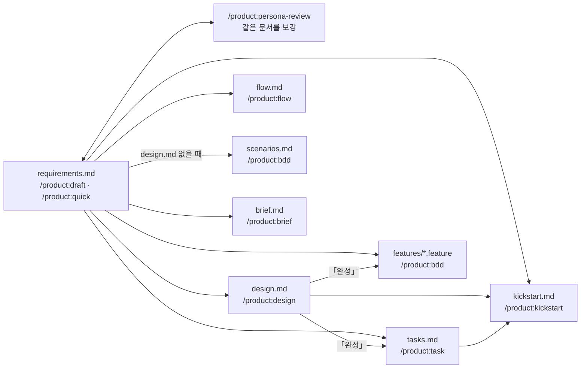

# product 결과물

product 명령이 남기는 결과물과, 결과물끼리 무엇을 읽는지 정리한 문서다. 명령을 고르는 순서는 [WORKFLOW.md](WORKFLOW.md) 에 있다.

## 어디에 남는가

모든 결과물은 요청 하나당 기능 폴더 하나에 모인다. 기능 폴더는 `/product:setup` 으로 셋업한 product 폴더(`.product/`)의 `features/` 아래에 있다. 경로를 정하는 규칙은 `references/spec-format.md` 「저장 위치」 한 곳에 있다.

```text
{product 폴더}/features/{yymmdd}_{feature_summary}/
  requirements.md          # /product:draft 또는 /product:quick. 맨 끝 「참여자별 검토 기록」은 /product:persona-review 가 쓴다
  design.md
  flow.md
  tasks.md
  brief.md                 # 윤문을 거치지 않는다
  kickstart.md             # /product:kickstart 의 인수인계 문서. 커밋하지 않는다
  scenarios.md             # requirements.md 경로로, 또는 design.md 없는 폴더로 /product:bdd
  features/{도메인}/<actor>-<flow>.feature   # design.md 가 있을 때 /product:bdd
  _humanize/                # {파일 이름}.before 가 윤문 전 원문. 윤문 도구의 작업 파일도 여기 모인다
```

`/product:quick` 도 새 기능 폴더를 만들고 `requirements.md` 를 쓴다. 「참여자」 같은 해당 없는 절이 빠지고, 맨 뒤에 「설계」 절이 있다. 뒤 단계 명령은 draft 의 문서처럼 이 파일을 읽는다.

features/, scenarios.md, kickstart.md, brief.md 를 뺀 마크다운 결과물은 다 쓴 뒤 윤문을 거친다. 언제 거치고 무엇을 지키는지는 [[polish-keeps-content]] 에, 어떤 도구로 하는지는 [[polish-tool]] 에 있다.

윤문 대상 문서와 brief.md 는 제목 바로 아래 한 줄에 작성일자·저자·윤문 여부를 적는다. 윤문을 거쳤으면 윤문 도구의 이름과 버전이 붙는다(예: `2026-11-25 · @kanghyunlee · 윤문 some-tool@market 1.2.3`). 줄 모양은 `references/spec-format.md` 「문서 머리말」 한 곳에 있다.

## 의존관계



화살표는 "뒤 문서가 앞 문서를 읽는다" 는 뜻이다. 「완성」 이 붙은 화살표는 앞 문서가 `references/design.md` 「완성」 조건을 채워야 뒤 문서를 쓸 수 있다는 뜻이다.

## 앞 문서가 없을 때

그림에 없는 동작만 적는다.

- requirements.md: 앞 문서가 없다. draft 는 넘겨받은 문서에서, quick 은 채팅에서 시작한다
- persona-review: requirements.md 가 없으면 고치지 않고 `/product:draft` 를 안내한다. 새 파일을 만들지 않는다
- design.md: requirements.md 가 없으면 쓰지 않고 `/product:draft` 를 안내한다. requirements.md 에 열린 결정이 남아 있어도 쓴다
- tasks.md: 둘 중 하나라도 없으면 쓰지 않고 빠진 문서를 만드는 명령을 안내한다. design.md 가 「완성」 이 아니면 남은 결정을 알려 준다
- features/, scenarios.md: requirements.md 가 없으면 쓰지 않고 `/product:draft` 를 안내한다. requirements.md 경로를 받거나 폴더에 design.md 가 없으면 scenarios.md 를 쓴다. 열린 결정이 남아 있어도 멈추지 않고, 정해지지 않은 인수 조건은 scenarios.md 「미결 사항」에 남긴다. 그 밖에는 features/ 를 쓰고, design.md 가 「완성」 이 아니면 남은 결정을 알려 준다
- kickstart.md: 세 문서 중 하나라도 없으면 쓰지 않고 빠진 문서를 만드는 명령을 안내한다. tasks.md 에 남은 작업이 없으면 새 세션을 띄우지 않는다
- flow.md: requirements.md 가 없으면 쓰지 않고 `/product:draft` 를 안내한다. design.md 는 없어도 쓴다. requirements.md 에 열린 결정이 남아 있어도 추천안으로 그린다
- brief.md: requirements.md 가 없으면 쓰지 않고 `/product:draft` 를 안내한다

## 앞 문서가 바뀌었을 때

화살표를 따라 뒤 문서를 다시 부른다.

- requirements.md 를 고쳤다 → `/product:design` 으로 설계에 반영한 뒤, 아래 design.md 줄을 따른다. brief 를 썼다면 `/product:brief`, 화면흐름을 썼다면 `/product:flow`, scenarios.md 를 썼다면 `/product:bdd {requirements.md 경로}` 도 다시 부른다
- design.md 를 고쳤다 → `/product:task`, `/product:bdd` 를 다시 부른다
    - tasks.md 는 이미 끝난(`done`) 작업을 그대로 두고 고친다
- features/, scenarios.md, flow.md, brief 문서는 다른 문서가 읽지 않는다. 고쳐도 다시 부를 명령이 없다
- tasks.md 를 고쳤다 → 이미 띄운 지휘 세션은 tasks.md 를 다시 읽으면 된다. kickstart.md 는 tasks.md 를 가리키기만 해서 다시 쓸 것이 없다
