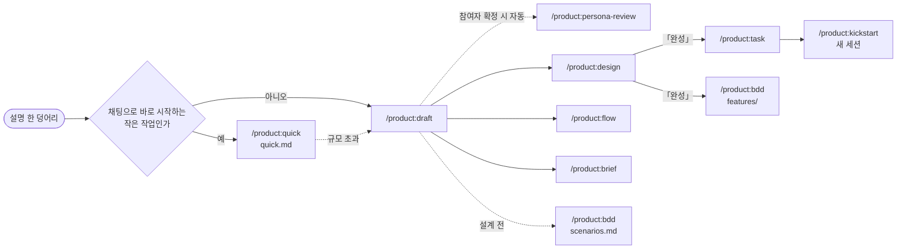

# product 작업 흐름

어떤 명령을 어떤 순서로 쓰는지 정리한 문서다. 각 결과물이 무엇을 읽고 어디에 남는지는 [OUTPUT.md](OUTPUT.md) 에 있다. 명령마다의 세부 규칙은 각 `skills/{이름}/SKILL.md` 에 있다.

## 첫 갈림길

- 채팅으로 바로 시작하는 작은 작업 → `/product:quick {설명}`
    - 스펙과 작은 설계를 새 기능 폴더의 `quick.md` 한 장으로 받는다
    - "작은 작업" 의 기준은 `skills/quick/SKILL.md` 「규모 확인」에 있다. 기준을 넘으면 quick 이 `/product:draft` 를 권한다
- 다른 문서(회의록·기획서·wiki)에서 넘어온 내용으로 시작하는 작업, 또는 큰 작업 → 아래 「기본 흐름」

화살표는 "앞 명령이 끝나야 뒤 명령을 쓸 수 있다" 는 뜻이다. `task` 와 `bdd` 는 같은 설계를 받아 나란히 쓸 수 있다. 점선의 `bdd` 는 requirements.md 경로로, 또는 design.md 가 없는 폴더로 부른 같은 명령이다.

## 기본 흐름

- `/product:setup`: 처음 한 번, 문서를 쓰기 전에 부른다. 리포지토리 외부 셋업과 내부 셋업 중 하나를 골라 product 폴더(`.product/`)를 만든다. 셋업하지 않으면 문서를 쓰는 스킬이 쓰지 않고 setup 을 안내한다
- `/product:draft {설명}`: 넘겨받은 문서와 설명을 바탕으로 무엇을 만드는지 요구사항 문서로 쓴다. 이 흐름의 시작점이고, 요청 하나에 기능 폴더 하나를 만든다
    - 설명에 참여자를 나열하면 draft 가 문서를 다 쓴 뒤 `product:persona-review` 를 불러 참여자별로 빠진 과정을 채운다. 나열하지 않으면 참여자 목록 결정에 답한 뒤 부른다
- `/product:design {폴더}`: 어떻게 만드는지 설계 문서로 쓴다. 요구사항 문서에 열린 결정이 남아 있어도 쓸 수 있다
- 설계 문서가 「완성」 이 될 때까지 결정에 답한다 (아래 「결정에 답하기」)
- `/product:task {폴더}`: 어떤 순서로 만드는지 작업 DAG 로 쓴다
- `/product:bdd {폴더}`: 설계 문서가 E2E·통합으로 정한 인수 조건을 Gherkin 시나리오(`features/*.feature`)로 쓴다
- `/product:kickstart {폴더}`: 구현에 착수한다. 세 문서와 지금 세션의 맥락을 인수인계 문서(`kickstart.md`)로 묶고, fable 모델의 새 세션을 백그라운드로 띄운다
    - 새 세션은 지시와 검수만 하고, 코드 수정과 커밋은 서브에이전트에 맡긴다. 역할 규칙은 `references/kickstart.md` 「역할 규칙」에 있다
    - 띄운 세션은 `claude attach {잡 id}` 로 본다. 지금 세션에서 바로 구현하려면 kickstart 없이 tasks.md 를 보고 시작한다

## 곁가지

- 화면이 바뀌는 기능일 때: 요구사항 문서가 생긴 뒤, pug-frame 와이어프레임을 그리기 전에 `/product:flow {폴더}`
    - 흐름도와 화면 표로 어느 화면에 무엇이 끼어드는지 먼저 맞춘다. design.md 가 없어도 쓸 수 있다
    - 이미 그린 와이어프레임이 있으면 경로를 함께 넘긴다. 고칠 행 목록이 생긴다
- 정해진 인수 조건을 예시로 맞춰 볼 때: 요구사항 문서가 생긴 뒤 `/product:bdd {requirements.md 경로}`
    - `scenarios.md` 에 시나리오와 「미결 사항」이 생긴다. 규칙은 `skills/bdd/SKILL.md` 「기획 경로」에 있다
    - 결정에 답한 뒤 같은 명령을 다시 부르면 미결 사항이 시나리오로 바뀐다
- 다른 사람과 기획을 나눌 때: 요구사항 문서가 생긴 뒤 언제든 `/product:brief {폴더}`
    - 받은 사람은 `brief.md` 의 `# LLM 맥락용` 제목 앞까지만 읽으면 된다
- 공유 문서로 만들 때: 설명에 "artifact" 또는 "아티팩트" 를 넣는다. draft·brief 가 로컬 마크다운 대신 공유 문서로 쓴다
- 이미 있는 요구사항 문서를 참여자별로 다시 검토할 때: `/product:persona-review {폴더}`. 「참여자별 검토 기록」에 없는 참여자만 검토한다

## 결정에 답하기

모든 단계에서 같은 방식으로 답한다.

- 문서의 「필요한 결정」 에서 ID 와 옵션을 고른다. 예: `A1. a`, `S2. b`
- 답하면 LLM 이 같은 문서를 고친다. 새 문서를 만들지 않는다
- 앞 단계 문서의 결정이 바뀌면 뒤 단계 문서를 다시 부른다. 무엇을 다시 불러야 하는지는 [OUTPUT.md](OUTPUT.md) 「앞 문서가 바뀌었을 때」 에 있다

결정 ID, 마커, 답을 반영하는 모양은 `references/spec-format.md` 에 있다.
